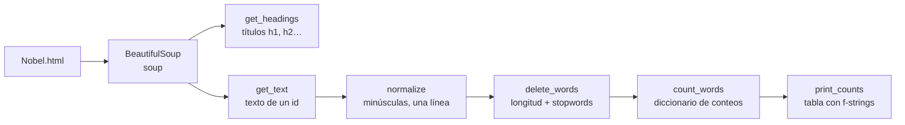

# Tarea 1 — Introducción al NLP (Taller 1: Web Scraping)

| | |
|---|---|
| **Módulo** | Procesamiento y entendimiento de lenguaje natural (MLDS 4) · Unidad 1: Introducción a NLP |
| **Archivo** | [CL_taller1v2.ipynb](CL_taller1v2.ipynb), plantilla oficial **sin resolver** |
| **Fecha de entrega** | 27 de agosto de 2026 (Classroom) |
| **Calificación** | Automática en **UNCode**, curso `PYEDLN-GroupMLDS-4-2026-2`: [página de la tarea](https://uncode.unal.edu.co/course/PYEDLN-GroupMLDS-4-2026-2/fe4d93cf-f861-4a71-b1d3-8c91a7dd7b25) |
| **Estructura** | 85 celdas · 6 funciones calificadas · 12 pruebas + envío final |

## 1. ¿De qué trata la tarea?

Se extrae y limpia texto de una página web guardada como **HTML**: el anexo de Wikipedia en español con los ganadores del Premio Nobel de Física. La tarea recorre el flujo básico para obtener texto de la web:

1. Leer el HTML con **BeautifulSoup**.
2. Ubicar secciones por **etiqueta** o por **`id`**.
3. Extraer el texto sin etiquetas.
4. **Normalizarlo** (minúsculas, sin espacios sobrantes, en una sola línea).
5. **Filtrar palabras** por longitud y por una lista de exclusión (*stopwords*).
6. **Contar palabras** y presentar el conteo como **tabla con f-strings**.

Integra los tres talleres guiados de la unidad: manejo de archivos, obtención de textos y manipulación de *strings*.

> La tarea es incremental: cada función reutiliza la anterior (`get_text` → `normalize` → `delete_words` → `count_words` → `print_counts`).

## 2. Flujo general



## 3. Preparación (celdas 0–12)

1. **Conexión a UNCode:** se instala `rlxcrypt`, se descarga `session.pye` y se crea el objeto `grader` del curso `PYEDLN-GroupMLDS-4-2026-2`.
2. **Carga del HTML:** se descarga `Nobel.html` desde Google Drive con `wget`, se visualiza con `IPython.display.HTML` y se abre como texto plano.
3. **Objeto `soup`:** `bs4.BeautifulSoup(raw_data)` convierte el HTML en un árbol que se puede recorrer por etiquetas, atributos e `id`.

## 4. Funciones de la tarea

### 4.1 Extracción de títulos · `get_headings(soup, head_n)`
- **Qué pide:** devolver una lista con el texto de **todos** los títulos del nivel indicado (`<h1>`, `<h2>`, …).
- **Herramienta:** `find_all` devuelve todas las coincidencias; `find` solo la primera. Según la pista, la búsqueda debe limitarse al **contenido** de la página, que en Wikipedia tiene un `id` propio. Así no se cuelan títulos del menú o del pie de página.
- **Cómo se verifica:**

  | Llamado | Resultado esperado |
  |---|---|
  | `get_headings(soup, 1)` | `['Anexo:Ganadores del Premio Nobel de Física']` |
  | `get_headings(soup, 2)` | `['Galardonados', 'Galardonados por país', 'Véase también', 'Referencias', 'Enlaces externos']` |

- **Pruebas:** `Test 1_1`, `Test 1_2`.

### 4.2 Texto de una sección · `get_text(soup, id)`
- **Qué pide:** devolver como **cadena** todo el texto de la sección con ese `id`, **sin etiquetas HTML**.
- **Herramienta:** como los `id` son únicos en HTML, basta `find` para ubicar el elemento y `get_text()` para quitar las etiquetas.
- **Cómo se verifica:** con `firstHeading` (título de la página), `footer` (pie de página) y los primeros 1.000 caracteres de `bodyContent` (cuerpo del artículo).
- **Pruebas:** `Test 2_1`, `Test 2_2`.

### 4.3 Normalización · `normalize(soup, id)`
- **Qué pide:** a partir del texto de la sección, en este orden:
  1. separar por saltos de línea;
  2. pasar a **minúsculas**;
  3. quitar los espacios al **inicio y final de cada línea**;
  4. **unir las líneas con un espacio** para formar una sola línea.
- **Por qué:** estandariza el texto antes de cualquier análisis. Así "Nobel", "NOBEL" y " nobel " se tratan como la misma palabra.
- **Herramientas:** `lower()`, `split()`, `strip()` y `" ".join(...)`.
- **Pruebas:** `Test 3_1`, `Test 3_2`.

### 4.4 Eliminación de palabras · `delete_words(soup, id, min_len, max_len, stops)`
- **Qué pide:**
  1. normalizar la sección;
  2. separar por espacios para obtener *tokens*;
  3. conservar solo los de longitud entre `min_len` y `max_len`;
  4. eliminar los que estén en la lista `stops`;
  5. unir con espacios.
- **Por qué:** las palabras muy cortas o muy frecuentes ("de", "la", "a") aportan poca información léxica.
- **Herramientas:** sentencias `if`, comprensiones de lista o `filter(función, iterable)`, y `join`.
- **Cómo se verifica:** con la tabla de contenido (`vector-toc-pinned-container`, longitudes de 1 a 23) y con el pie de página (longitudes de 3 a 10).
- **Pruebas:** `Test 4_1`, `Test 4_2`.

### 4.5 Conteo de palabras · `count_words(soup, id, min_len, max_len, stops, words)`
- **Qué pide:** después de eliminar palabras como en el punto 4.4, devolver un **diccionario** `{palabra: número de apariciones}` para cada palabra de `words`.
- **Cómo se verifica** (sobre `bodyContent`, longitudes de 3 a 10):

  | Palabras | Resultado esperado |
  |---|---|
  | `["nobel", "alemania"]` | `{'nobel': 269, 'alemania': 7}` |
  | `["academia", "física"]` | `{'academia': 3, 'física': 28}` |
  | `["alfred", "sueca", "comité", "guerra"]` | `{'alfred': 5, 'sueca': 4, 'comité': 1, 'guerra': 1}` |

- **Ojo:** contar en la **cadena** (`texto.count("nobel")`) cuenta subcadenas, así que también encuentra "nobel" dentro de "nobelpriset". Contar en la **lista de tokens** cuenta palabras completas. La salida esperada dice cuál de los dos criterios usa el autograder.
- **Pruebas:** `Test 5_1`, `Test 5_2`.

### 4.6 Tabla de conteos · `print_counts(soup, id, min_len, max_len, stops, words)`
- **Qué pide:** devolver los conteos del punto 4.5 como **tabla de texto** con dos columnas, `Palabra` y `Conteo`, de **20 caracteres de ancho**, justificadas a la izquierda y con una fila de guiones bajo el encabezado:

  ```
  |Palabra             |Conteo              |
  |--------------------|--------------------|
  |nobel               |269                 |
  |alemania            |7                   |
  ```

- **Herramienta:** *f-strings* con formato de ancho y alineación, por ejemplo `f"|{palabra:<20}|"`, como en el taller guiado de manipulación de *strings*.
- **Pruebas:** `Test 6_1`, `Test 6_2`.

## 5. Envío
`grader.submit_task(globals())` envía todas las funciones a UNCode.

## 6. Resumen

| Punto | Función | Lo que hace | Pruebas |
|---|---|---|---|
| 1 | `get_headings` | Títulos `<hN>` del contenido | 1_1, 1_2 |
| 2 | `get_text` | Texto plano de una sección por `id` | 2_1, 2_2 |
| 3 | `normalize` | Minúsculas, *strip* por línea, una sola línea | 3_1, 3_2 |
| 4 | `delete_words` | Filtro por longitud y *stopwords* | 4_1, 4_2 |
| 5 | `count_words` | Diccionario de conteos | 5_1, 5_2 |
| 6 | `print_counts` | Tabla de 20 caracteres por columna | 6_1, 6_2 |

## 7. Detalles y erratas del enunciado
- **Nombre:** en Classroom se llama *Tarea 1: Introducción al NLP*; el notebook se titula *Taller 1: Web Scraping*.
- **Página distinta a la del enlace:** la introducción enlaza la lista en inglés de Wikipedia, pero el HTML que se descarga es el **anexo en español** (editado el 5 de febrero de 2025).
- **Salidas esperadas con el código equivocado:** en el punto 3 los bloques de ejemplo muestran `print(get_text(...))` cuando la celda llama a `normalize`. En el punto 4 el ejemplo del pie de página omite `"por"` y `"las"` de `stops`, aunque la celda sí los incluye.
- **`id` mal nombrado:** el punto 4 habla de la tabla de contenido "identificada con el *id* `toc`", pero la celda usa `vector-toc-pinned-container`.
- **Tipo de retorno de `print_counts`:** la plantilla inicia `values = []`, pero el enunciado pide una **tabla en formato f-string**, es decir, una cadena de texto.
- **Pista del punto 5:** dice "la función `counts`"; el método se llama `count`.
- Algunas salidas esperadas conservan marcas `<br>` del formato del enunciado; no forman parte del texto real.

## 8. Estado

| | |
|---|---|
| Notebook | Plantilla sin resolver |
| Resultado en UNCode | _Por registrar_ |
