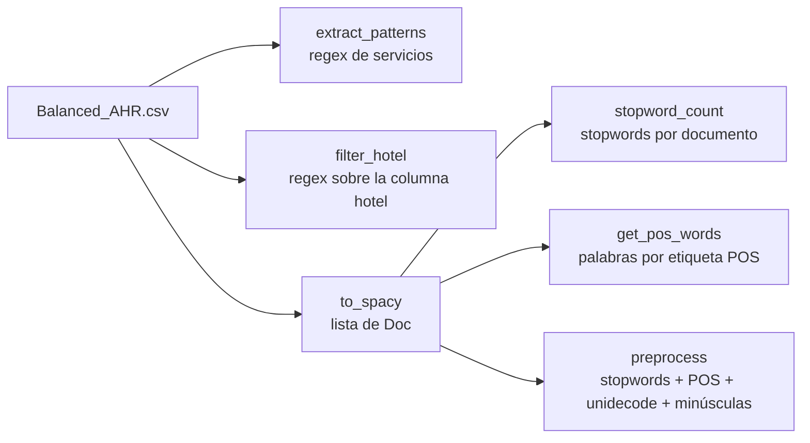

# Tarea 2 — Preprocesamiento A (Taller 2)

| | |
|---|---|
| **Módulo** | Procesamiento y entendimiento de lenguaje natural (MLDS 4) · Unidad 2: Preprocesamiento |
| **Archivo** | [CL_v2tarea_2.ipynb](CL_v2tarea_2.ipynb), plantilla oficial **sin resolver** |
| **Fecha de entrega** | 3 de septiembre de 2026 (Classroom) |
| **Calificación** | Automática en **UNCode**: [página de la tarea](https://uncode.unal.edu.co/course/PYEDLN-GroupMLDS-4-2026-2/4cc2f79e-1c99-44fe-bbb2-9e63d149aa72) |
| **Estructura** | 80 celdas · 6 funciones calificadas · 12 pruebas + envío final |

## 1. ¿De qué trata la tarea?

Se aplican las tres herramientas de la unidad 2 a **reseñas de hoteles de Andalucía** en español (dataset *Balanced_AHR* de Kaggle, 7.615 reseñas):

| Herramienta | Puntos | Para qué |
|---|---|---|
| **Expresiones regulares** (`re`) | 1 y 2 | Encontrar menciones de servicios y filtrar hoteles por patrón de nombre |
| **spaCy** | 3, 4 y 5 | Convertir textos en documentos, contar *stopwords* y filtrar palabras por categoría gramatical (POS) |
| **Preprocesamiento completo** | 6 | Encadenar filtros: *stopwords*, categorías POS, sin tildes (`unidecode`) y minúsculas |

**Columnas del dataset:** `title`, `rating` (1 a 5 estrellas), `review_text`, `location`, `hotel` y `label`. En `label`, las reseñas neutrales (3 estrellas) llevan el valor 3 y se descartan cuando la clasificación es binaria.

## 2. Flujo general

## 3. Funciones de la tarea

### 3.1 Patrones de servicios · `extract_patterns()`
- **Qué pide:** devolver una expresión regular **compilada** (`re.compile`) que encuentre en las reseñas las menciones de 8 servicios:
  - piscina, desayuno, almuerzo y cena;
  - wi-fi, gimnasio, lavandería y sauna.
- **La dificultad:** las palabras aparecen con **mayúsculas, tildes y guiones**: `wifi`, `Wi-Fi`, `lavanderia`, `lavandería`. La expresión debe aceptar todas esas variantes.
- **Cómo se verifica** con `df['review_text'].str.findall(pat)`:

  | Reseña | Resultado esperado |
  |---|---|
  | 1 | `['piscina', 'piscina', 'wifi']` |
  | 4712 | `['piscina', 'Wi-Fi', 'piscina']` |
  | 1066 | `['lavanderia']` |
  | 3197 | `['desayuno', 'desayuno', 'lavandería']` |

- **Pruebas:** `Test 1_1`, `Test 1_2`.

### 3.2 Filtrar hoteles por patrón · `filter_hotel(df, pat)`
- **Qué pide:** devolver solo las filas cuyo `hotel` cumpla la expresión `pat`.
- **Herramientas:** `Series.str.contains(pat)` o `apply` con `pat.search`.
- **Cómo se verifica:**
  - `^[A].*$`, hoteles que empiezan por "A": **62** hoteles distintos, encabezados por `Apartamentos_Torre_de_la_Plata` (32 reseñas).
  - `^.*on$`, hoteles que terminan en "on": 8 hoteles, desde `Hotel_Casa_de_Colon` (29) hasta `Ohtels_San_Anton` (4).
- **Pruebas:** `Test 2_1`, `Test 2_2`.

### 3.3 Documentos de spaCy · `to_spacy(df, nlp)`
- **Qué pide:** convertir la columna `review_text` en una **lista de objetos `Doc`** con el *pipeline* `nlp`. Se usa el modelo `es_core_news_sm`.
- **Herramientas:** `nlp.pipe(textos)` procesa en lote, que es más rápido, o se llama a `nlp(texto)` uno por uno. El resultado debe convertirse a `list`.
- **Cómo se verifica:** `type(corpus)` es `list` y `type(corpus[0])` es `spacy.tokens.doc.Doc`.
- **Pruebas:** `Test 3_1`, `Test 3_2`.

### 3.4 Conteo de *stopwords* · `stopword_count(corpus)`
- **Qué pide:** una lista con el número de *stopwords* de cada documento.
- **Herramienta:** cada `Token` tiene el atributo `is_stop`; basta sumarlo dentro de cada documento.
- **Cómo se verifica:** para las 10 primeras reseñas, `[96, 52, 26, 21, 25, 29, 79, 80, 41, 48]`. Además se grafica un histograma de la distribución.
- **Detalle:** la prueba carga el *pipeline* **sin** `ner`, `parser`, `lemmatizer` ni otros componentes. Para marcar *stopwords* no hacen falta, y así procesa las 7.615 reseñas mucho más rápido.
- **Pruebas:** `Test 4_1`, `Test 4_2`.

### 3.5 Palabras por categoría gramatical · `get_pos_words(corpus, pos_list)`
- **Qué pide:** para cada documento, una **cadena** con las palabras cuya etiqueta POS gruesa (`token.pos_`) esté en `pos_list`, unidas por espacios.
- **Cómo se verifica:**
  - Verbos de la segunda reseña: `'tiene llegaba cortaba ocurre poner'`.
  - Verbos y sustantivos de la primera: `'fin semana pareja hicimos reserva hotel …'`.
- **Pruebas:** `Test 5_1`, `Test 5_2`.

### 3.6 Preprocesamiento · `preprocess(doc, pos_list)`
- **Qué pide:** encadenar cuatro pasos sobre un `Doc` y devolver una cadena:
  1. quitar *stopwords*;
  2. conservar solo las categorías POS indicadas;
  3. quitar tildes y caracteres especiales con `unidecode`;
  4. pasar a minúsculas.
- **Por qué:** deja solo las palabras con contenido (verbos, sustantivos, nombres propios), escritas de forma uniforme. Esa entrada es la que usan después la bolsa de palabras y los modelos.
- **Cómo se verifica:**
  - Primera reseña con `["VERB", "NOUN"]`: `'semana pareja hicimos reserva hotel descansar …'`. Al quitar *stopwords* desaparece "fin".
  - Segunda reseña con `["NOUN", "PROPN"]`: `'hotel general habtiaciones espaciosas …'`.
- **Pruebas:** `Test 6_1`, `Test 6_2`.

## 4. Resumen

| Punto | Función | Lo que hace | Pruebas |
|---|---|---|---|
| 1 | `extract_patterns` | Regex de 8 servicios con variantes | 1_1, 1_2 |
| 2 | `filter_hotel` | Filtra filas por patrón en `hotel` | 2_1, 2_2 |
| 3 | `to_spacy` | Textos → lista de `Doc` | 3_1, 3_2 |
| 4 | `stopword_count` | *Stopwords* por documento | 4_1, 4_2 |
| 5 | `get_pos_words` | Palabras de ciertas categorías POS | 5_1, 5_2 |
| 6 | `preprocess` | *Stopwords* + POS + `unidecode` + minúsculas | 6_1, 6_2 |

## 5. Detalles y erratas del enunciado
- **Nombre:** en Classroom se llama *Tarea 2: preprocesamiento A*; el notebook se titula *Taller 2*.
- **Pista del punto 1:** menciona URLs ("las URL normalmente usan caracteres alfanuméricos…"). Viene de otro ejercicio y no aplica a los servicios de hotel.
- **Comentario del punto 2:** dice "FUNCIÓN CALIFICADA filter_type", pero la función se llama `filter_hotel`.
- **Mensaje final:** dice "Ha terminado la tarea de la Unidad 1"; es la unidad 2.
- **Errores de escritura del dataset:** algunas salidas esperadas los conservan, por ejemplo "habtiaciones". No hay que corregirlos.
- **Dependencias:** hay que instalar `unidecode` y descargar el modelo `es_core_news_sm`, como hacen las celdas del notebook.

## 6. Estado

| | |
|---|---|
| Notebook | Plantilla sin resolver |
| Resultado en UNCode | _Por registrar_ |
