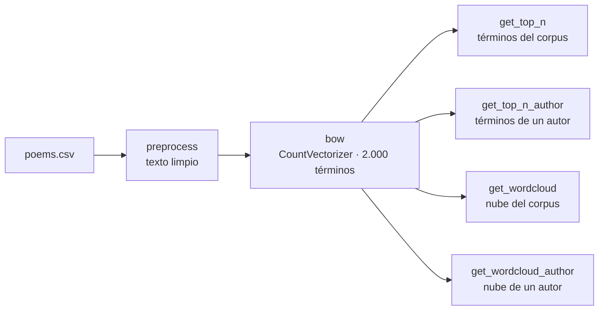

# Tarea 3 — Embeddings (bolsa de palabras)

| | |
|---|---|
| **Módulo** | Procesamiento y entendimiento de lenguaje natural (MLDS 4) · Unidad 3: Embeddings |
| **Archivo** | [CL_v2tarea_3.ipynb](CL_v2tarea_3.ipynb), plantilla oficial **sin resolver** |
| **Fecha de entrega** | 10 de septiembre de 2026 (Classroom) |
| **Calificación** | Automática en **UNCode**: [página de la tarea](https://uncode.unal.edu.co/course/PYEDLN-GroupMLDS-4-2026-2/30e0bc3f-13c0-43a7-b27b-cc4551cdd51f) |
| **Estructura** | 78 celdas · 6 funciones calificadas · 12 pruebas + envío final |

## 1. ¿De qué trata la tarea?

Se convierte un corpus de **5.133 poemas en español** (*Spanish Poetry Dataset*, Kaggle; columnas `author`, `content` y `title`) en una **representación numérica**. Con ella se analiza el vocabulario del corpus y el de cada autor:

1. **Preprocesar** los poemas: minúsculas, sin tildes, solo letras, sin *stopwords* ni palabras cortas.
2. Construir una **bolsa de palabras** (*bag of words*) con los **2.000 términos más frecuentes**.
3. Extraer los **N términos más frecuentes** del corpus y de un autor.
4. Visualizarlos con **nubes de palabras**, también para el corpus completo y por autor.

> A pesar del nombre de la unidad, esta tarea trabaja la **bolsa de palabras por conteos** (`CountVectorizer`), la primera forma de representar texto como vectores. Los *embeddings* densos (Word2Vec, Doc2Vec, FastText con Gensim) se ven en los talleres guiados de la unidad.

## 2. Flujo general

## 3. Funciones de la tarea

### 3.1 Preprocesamiento · `preprocess(text, nlp)`
- **Qué pide:** aplicar a un texto crudo, en este orden:
  1. pasar a **minúsculas**;
  2. eliminar **tildes** con `unidecode`;
  3. eliminar todo lo que **no sea una letra minúscula**, con una regex;
  4. eliminar **espacios duplicados**;
  5. filtrar ***stopwords*** y palabras de **3 letras o menos**;
  6. quitar espacios al inicio y al final.
- **El *pipeline* de spaCy** se carga sin componentes extra y, según la pista, se usa **solo para identificar *stopwords***.
- **Cómo se verifica:** el primer poema empieza por `'parque confuso languidas brisas cielo sahuma …'` y el segundo por `'velas vendre ladron llegar sepas hora …'`.
- **Pruebas:** `Test 1_1`, `Test 1_2`.

### 3.2 Bolsa de palabras · `bow(preprocess_corpus)`
- **Qué pide:** entrenar un `CountVectorizer` con los **2.000 términos más frecuentes** (`max_features=2000`) y devolver:
  - la matriz como arreglo de NumPy (`toarray()`);
  - el vectorizador entrenado.
- **Qué representa:** cada fila es un poema y cada columna una palabra del vocabulario. El valor es cuántas veces aparece esa palabra en ese poema.
- **Cómo se verifica:**

  | Comprobación | Resultado esperado |
  |---|---|
  | `X.shape` | `(5133, 2000)` |
  | Primeras palabras del vocabulario | `['abajo', 'abandonado', 'abandono', 'abeja', …]`, en orden alfabético |
  | `X.sum()` (palabras contadas en total) | `198682` |

- **Pruebas:** `Test 2_1`, `Test 2_2`.

### 3.3 Términos más frecuentes · `get_top_n(X, vect, n)`
- **Qué pide:** sumar los conteos de cada columna en todo el corpus y devolver las `n` palabras con más apariciones, de mayor a menor.
- **Cómo se verifica:**
  - Top 5: `['amor', 'vida', 'noche', 'ojos', 'tierra']`.
  - Top 10: el top 5 más `alma`, `muerte`, `tiempo`, `cielo` y `corazon`.
- **Pruebas:** `Test 3_1`, `Test 3_2`.

### 3.4 Términos más frecuentes de un autor · `get_top_n_author(X, vect, n, authors, author_query)`
- **Qué pide:** lo mismo, pero solo con las filas de `X` del autor indicado. La lista `authors` está alineada con las filas de `X`.
- **Herramienta:** una **máscara booleana** de NumPy (`np.array(authors) == author_query`) para seleccionar filas, y reutilizar `get_top_n`.
- **Cómo se verifica:**
  - Marilina Rébora: `['dios', 'amor', 'alma', 'senor', 'madre', …]`.
  - Antonio Colinas: `['muerte', 'musica', 'ojos', 'vida', 'amor', 'bosque', …]`.
- **Pruebas:** `Test 4_1`, `Test 4_2`.

### 3.5 Nube de palabras · `get_wordcloud(X, vect)`
- **Qué pide:** un objeto `WordCloud` con **fondo blanco**, generado a partir de las frecuencias de la bolsa de palabras.
- **Herramienta:** `WordCloud(background_color="white").generate_from_frequencies({palabra: conteo})`.
- **Pruebas:** `Test 5_1`, `Test 5_2`. La imagen puede variar en la posición de las palabras.

### 3.6 Nube de palabras por autor · `get_wordcloud_author(X, vect, authors, author_query)`
- **Qué pide:** la misma nube, pero con las filas del autor. La prueba la dibuja para Leopoldo Lugones, Antonio Colinas y Marilina Rébora.
- **Pruebas:** `Test 6_1`, `Test 6_2`.

## 4. Resumen

| Punto | Función | Lo que hace | Pruebas |
|---|---|---|---|
| 1 | `preprocess` | Limpieza en 6 pasos | 1_1, 1_2 |
| 2 | `bow` | `CountVectorizer` con 2.000 términos | 2_1, 2_2 |
| 3 | `get_top_n` | N palabras más frecuentes | 3_1, 3_2 |
| 4 | `get_top_n_author` | Lo mismo para un autor (máscara) | 4_1, 4_2 |
| 5 | `get_wordcloud` | Nube del corpus, fondo blanco | 5_1, 5_2 |
| 6 | `get_wordcloud_author` | Nube de un autor | 6_1, 6_2 |

## 5. Detalles y erratas del enunciado
- **Columnas:** dice "este conjunto de datos contiene dos columnas", pero enumera tres (`author`, `content` y `title`).
- **Salidas del punto 4:** dicen "las 10 palabras más frecuentes del corpus **en el año 2019**" y "**en el año 2020**", pero la función filtra por **autor**. Es un texto copiado de otro ejercicio.
- **Tipo del parámetro:** `preprocess_corpus` aparece como `str`, pero es una serie de pandas con un texto por poema.
- **Errores de escritura:** "ue tomará" en lugar de "que tomará"; título "Nube de Palabras Por author".
- **Mensaje final:** dice "Ha terminado la tarea de la Unidad 1"; es la unidad 3.
- **Import innecesario:** `from typing import Counter` no se usa en la plantilla.
- Las palabras de las salidas esperadas aparecen sin tildes (`corazon`, `senor`, `musica`) porque el preprocesamiento aplica `unidecode`.

## 6. Estado

| | |
|---|---|
| Notebook | Plantilla sin resolver |
| Resultado en UNCode | _Por registrar_ |
