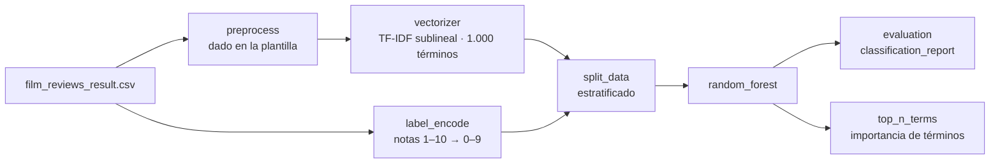

# Tarea 4 — Análisis supervisado (Taller 4)

| | |
|---|---|
| **Módulo** | Procesamiento y entendimiento de lenguaje natural (MLDS 4) · Unidad 4: Análisis supervisado en textos |
| **Archivo** | [CL_v2tarea_4.ipynb](CL_v2tarea_4.ipynb), plantilla oficial **sin resolver** |
| **Fecha de entrega** | 17 de septiembre de 2026 (Classroom) |
| **Calificación** | Automática en **UNCode**: [página de la tarea](https://uncode.unal.edu.co/course/PYEDLN-GroupMLDS-4-2026-2/30fd490f-ac0e-4c3b-bc7a-70b1d34feea8) |
| **Estructura** | 88 celdas · 6 funciones calificadas · 12 pruebas + envío final |

## 1. ¿De qué trata la tarea?

Se entrena un **clasificador de textos** que predice la calificación de una crítica de cine a partir de su texto. El dataset son **10.058 reseñas en español de FilmAffinity**:

| | |
|---|---|
| **Entrada** | `review_text`, el texto de la crítica, ya preprocesado por la plantilla |
| **Etiqueta** | `review_rate`, la nota del usuario de **1 a 10**: **10 clases**, desbalanceadas |
| **Representación** | **TF-IDF** con escala sublineal y 1.000 términos |
| **Modelo** | **Bosque aleatorio** (*Random Forest*) |
| **Evaluación** | Reporte de clasificación por clase e importancia de cada término |

Es el flujo completo de aprendizaje supervisado sobre texto:

texto → vector → etiqueta codificada → partición → modelo → evaluación → interpretación

## 2. Flujo general

## 3. Preparación (dada en la plantilla)

La plantilla trae un `preprocess` que hace lo siguiente con cada reseña:
- quita *stopwords* y palabras de 3 caracteres o menos, o de 24 o más;
- pasa a minúsculas y quita tildes con `unidecode`;
- deja solo letras y elimina espacios duplicados.

El resultado se guarda en la columna `corpus`.

**Ojo:** ese `preprocess` usa `spacy.blank("en")`, es decir, la lista de *stopwords* del **inglés** aplicada a textos en **español**. Por eso sobreviven palabras como "pero", "aunque", "cada" y "poco", que luego aparecen entre los términos más importantes del modelo (punto 6).

## 4. Funciones de la tarea

### 4.1 Extracción de características · `vectorizer(corpus)`
- **Qué pide:** entrenar un `TfidfVectorizer` con `sublinear_tf=True` y `max_features=1000`. Devuelve la matriz como arreglo de NumPy y el vectorizador.
- **Por qué TF-IDF:** pondera cada palabra según su frecuencia en la reseña y la penaliza si aparece en casi todas. La **escala sublineal** usa 1 + log(tf) en lugar de tf, para que una palabra repetida 20 veces no pese 20 veces más.
- **Cómo se verifica:**

  | Comprobación | Resultado esperado |
  |---|---|
  | Forma | `(10058, 1000)` |
  | Primeras palabras del vocabulario | `['absolutamente', 'absoluto', 'absurdo', 'aburrida', 'acaba']` |
  | Suma de la matriz | `69922.60724691708` |

- **Pruebas:** `Test 1_1`, `Test 1_2`.

### 4.2 Codificación de etiquetas · `label_encode(labels)`
- **Qué pide:** ajustar un `LabelEncoder` sobre las notas y devolver las etiquetas codificadas y el codificador.
- **Cómo se verifica:**

  | Comprobación | Resultado esperado |
  |---|---|
  | Forma | `(10058,)` |
  | Media de las etiquetas | `4.852455756611652` |
  | `classes_` | `[1 … 10]`: la nota 1 queda como 0 y la 10 como 9 |

- **Pruebas:** `Test 2_1`, `Test 2_2`.

### 4.3 Partición estratificada · `split_data(features, labels, test_size, seed)`
- **Qué pide:** `train_test_split` con `stratify=labels` y `random_state=seed`, para conservar la proporción de cada nota en las dos partes.
- **Cómo se verifica:**
  - Con `test_size=0.3`: 7.040 reseñas de entrenamiento y 3.018 de prueba.
  - La media de las etiquetas es casi igual en ambas (4,853 y 4,851), señal de que la estratificación funcionó.
- **Pruebas:** `Test 3_1`, `Test 3_2`.

### 4.4 Bosque aleatorio · `random_forest(features_train, labels_train, max_depth, n_estimators, seed)`
- **Qué pide:** entrenar un `RandomForestClassifier` con la profundidad, el número de árboles y la semilla indicados.
- **Cómo se verifica:** `model.max_depth == 5` y `model.n_estimators == 50`.
- **Pruebas:** `Test 4_1`, `Test 4_2`.

### 4.5 Evaluación · `evaluation(model, features_test, labels_test)`
- **Qué pide:** devolver el `classification_report` de sklearn, un texto con precisión, *recall* y F1 por clase.
- **Salida esperada** (profundidad 5, 50 árboles, 30 % de prueba):

  | Métrica | Valor |
  |---|---|
  | Accuracy | **0,19** |
  | F1 macro | **0,07** |

  El modelo casi solo predice las notas 6 y 7 (clases 5 y 6): la clase 5 tiene *recall* de 0,79 y la mayoría de las clases tiene 0.
- **Cómo leerlo:** predecir siempre la nota más frecuente acertaría alrededor del **17 %** (507 de 3.018), así que el bosque mejora muy poco. Distinguir 10 notas a partir del texto es difícil, y un bosque poco profundo sobre TF-IDF no alcanza. La salida esperada lo muestra a propósito.
- **Pruebas:** `Test 5_1`, `Test 5_2`.

### 4.6 Importancia de términos · `top_n_terms(vect, model, n)`
- **Qué pide:** devolver las `n` palabras con mayor `feature_importances_` del bosque, de mayor a menor, usando el vocabulario de `get_feature_names_out()`.
- **Cómo se verifica:**
  - Top 5: `['mala', 'nada', 'netflix', 'entretenida', 'bastante']`.
  - Top 20: además `aburrida`, `excelente`, `notable`, `correcta`, `verguenza`, …
- **Lectura:** las palabras más útiles son **adjetivos de opinión** (mala, aburrida, excelente, notable, entretenida). Tiene sentido para predecir la nota de una crítica.
- **Pruebas:** `Test 6_1`, `Test 6_2`.

## 5. Resumen

| Punto | Función | Lo que hace | Pruebas |
|---|---|---|---|
| 1 | `vectorizer` | TF-IDF sublineal, 1.000 términos | 1_1, 1_2 |
| 2 | `label_encode` | Notas 1–10 → 0–9 | 2_1, 2_2 |
| 3 | `split_data` | Partición estratificada | 3_1, 3_2 |
| 4 | `random_forest` | Bosque con profundidad y árboles dados | 4_1, 4_2 |
| 5 | `evaluation` | `classification_report` | 5_1, 5_2 |
| 6 | `top_n_terms` | Términos más importantes | 6_1, 6_2 |

## 6. Detalles y erratas del enunciado
- **Nombre:** en Classroom se llama *Tarea 4: supervisado*; el notebook se titula *Taller 4*.
- **Tarea binaria frente a 10 clases:** la introducción habla de clasificar en "positivas o negativas", pero la tarea usa las **10 notas** como clases.
- ***Stopwords* en inglés:** el `preprocess` de la plantilla usa `spacy.blank("en")` sobre reseñas en español (sección 3).
- **Comentario del punto 6:** la celda de `top_n_terms` dice "FUNCIÓN CALIFICADA evaluation" y vuelve a importar `classification_report`, que no usa.
- **Pista del punto 2:** dice que se evite `fit_transform` "para poder guardar el codificador", pero `fit_transform` también deja el codificador ajustado. Lo importante es devolver el objeto ajustado.
- **Error de escritura:** "Uniersidad" en los créditos.

## 7. Estado

| | |
|---|---|
| Notebook | Plantilla sin resolver |
| Resultado en UNCode | _Por registrar_ |
