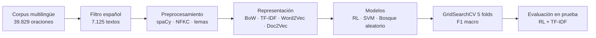

# Análisis de sentimiento en noticias económicas en español


Proyecto aplicado del módulo **Procesamiento y entendimiento de lenguaje natural**, *Diplomado Machine Learning and Data Science Avanzado*, Universidad Nacional de Colombia, 2026-2.

> **Clasificar automáticamente el sentimiento de oraciones de noticias financieras en español como negativo, neutral o positivo**, para apoyar el seguimiento de información económica que no se puede revisar a mano.

| Resultado en el conjunto de prueba | Valor |
|---|---|
| **F1 macro** | **0,66** |
| Accuracy | 0,67 |
| Recall por clase | Negativo 0,71 · Neutral 0,62 · Positivo 0,74 |
| Textos evaluados | 1.069 |
| Modelo final | TF-IDF de 1.024 términos con regresión logística y pesos balanceados |

---

## Contenido
1. [Problema](#1-problema)
2. [Datos](#2-datos)
3. [Metodología](#3-metodología)
4. [Resultados](#4-resultados)
5. [Limitaciones y trabajo futuro](#5-limitaciones-y-trabajo-futuro)
6. [Cómo reproducirlo](#6-cómo-reproducirlo)
7. [Estructura de la carpeta](#7-estructura-de-la-carpeta)
8. [Equipo y referencias](#8-equipo-y-referencias)

---

## 1. Problema

El volumen de noticias económicas que se publica cada día hace inviable revisarlas una por una. Además, el sentimiento financiero depende del contexto: *«reducción de pérdidas»* no es una mala noticia, y *«revisión a la baja»* sí lo es, aunque no contenga palabras negativas evidentes.

| | |
|---|---|
| **Objetivo** | Desarrollar un clasificador de sentimiento para textos financieros en español, con tres clases: negativo, neutral y positivo |
| **Usuarios** | Analistas y entidades que siguen noticias económicas en países de habla hispana |
| **Objetivos específicos** | Diseñar un preprocesamiento para español financiero, comparar representaciones de texto y modelos de *machine learning*, y evaluar el resultado de forma sistemática |
| **Métrica principal** | **F1 macro**, porque la clase neutral concentra el 54 % de los datos |

## 2. Datos

| | |
|---|---|
| **Fuente** | [*Multilingual Financial Sentiment*](https://huggingface.co/datasets/Kenpache/multilingual-financial-sentiment), publicado por Kenpache en Hugging Face: 39.829 oraciones financieras en 7 idiomas |
| **Subconjunto usado** | **7.125 oraciones en español** de 14 medios, entre ellos Expansión, El Confidencial, Bloomberg Línea, EFE, Cinco Días, Infobae y Portafolio |
| **Calidad** | Sin nulos, vacíos ni duplicados. Se identificaron 435 textos con problemas de codificación, que se conservan y se marcan con `encoding_flag` |
| **Longitud** | 33 palabras y 207 caracteres en promedio |

| Clase | Textos | % |
|---|---:|---:|
| Negativo | 1.641 | 23,0 |
| Neutral | 3.842 | 53,9 |
| Positivo | 1.642 | 23,1 |

La relación entre el medio de origen y la etiqueta es moderada, con un V de Cramér de 0,229. Por eso el medio **no se usa como predictor**: se conserva solo para auditar posibles sesgos editoriales.

## 3. Metodología

El proyecto siguió **CRISP-DM** en cuatro entregas semanales y una entrega final.



| Fase | Qué se hizo | Entregable |
|---|---|---|
| **1 · Negocio y carga de textos** | Problema, objetivos, plan con diagrama de Gantt y carga del corpus desde Hugging Face | [Fase 1](Proyecto/Fase%201-Entrega%201/README.md) |
| **2 · Entendimiento y preparación** | Análisis exploratorio de idiomas, fuentes, calidad, legibilidad, longitud y desbalance, y limpieza con spaCy | [Fase 2](Proyecto/Fase%202-Entrega%202/README.md) |
| **3 · Extracción de características** | Comparación de BoW, TF-IDF, Word2Vec y Doc2Vec según redundancia, correlación con la etiqueta, PCA y un modelo de verificación | [Fase 3](Proyecto/Fase%203-Entrega%203/README.md) |
| **4 · Modelamiento** | Seis combinaciones de representación y modelo, con búsqueda de hiperparámetros y validación cruzada | [Fase 4](Proyecto/Fase%204-Entrega%204/README.md) |
| **Entrega final** | Notebook integrado y presentación | [Entrega final](Proyecto/Entrega%20final/README.md) |

El detalle paso a paso de cada fase está en [docs/fases.md](docs/fases.md).

**Preprocesamiento con spaCy, modelo `es_core_news_sm`:**
1. Normalización Unicode NFKC y eliminación de caracteres inválidos.
2. Tokenización por lotes con `nlp.pipe`.
3. Las cifras, los porcentajes y los símbolos de moneda pasan a los marcadores `num`, `pct` y `moneda`. Así se conserva la señal sin multiplicar el vocabulario.
4. Se eliminan las *stopwords*, **excepto las negaciones** como «no», «nunca», «sin» y «ni», que invierten el sentido de una frase.
5. Lematización y paso a minúsculas.

Con esto la longitud media pasa de 33 palabras a 16,5 tokens, sin documentos vacíos y sin cambios en la distribución de clases.

## 4. Resultados

### 4.1 Comparación de modelos

F1 macro promedio de una validación cruzada de 5 folds sobre el conjunto de entrenamiento:

| Representación | Regresión logística | SVM con kernel RBF | Bosque aleatorio |
|---|---:|---:|---:|
| **TF-IDF** | **0,646** | 0,428 | 0,457 |
| Word2Vec | 0,567 | 0,313 | 0,353 |

### 4.2 Modelo final en prueba

| Clase | Precisión | Recall | F1 | Textos |
|---|---:|---:|---:|---:|
| Negativo | 0,55 | 0,71 | 0,62 | 228 |
| Neutral | 0,81 | 0,62 | 0,70 | 589 |
| Positivo | 0,58 | 0,74 | 0,65 | 252 |
| **Promedio macro** | 0,65 | 0,69 | **0,66** | 1.069 |

**Lectura de los resultados**
- **Las tres clases se detectan bien.** Frente a un azar de 0,33, el modelo llega a un F1 macro de 0,66, con un recall parejo entre clases, de 0,62 a 0,74, gracias a los pesos balanceados.
- **La clase neutral es la más difícil de capturar:** tiene la precisión más alta, 0,81, pero el menor recall, 0,62. Parte de las noticias neutrales se clasifican como positivas o negativas.
- **Casi todos los errores ocurren entre clases vecinas**, neutral frente a positivo o neutral frente a negativo; la confusión directa entre negativo y positivo es poca.
- **Los términos más asociados a cada clase tienen sentido económico:**
  - negativo: *caída, inflación, guerra, riesgo*;
  - positivo: *avance, impulsar, crecer, superar, ingreso*.

## 5. Limitaciones y trabajo futuro

| Limitación | Trabajo futuro |
|---|---|
| Las SVM y los bosques aleatorios se entrenaron con configuraciones restringidas: máximo 50 iteraciones y 100 muestras por árbol. La comparación los subestima | Volver a entrenarlos sin esas restricciones |
| En la fase 4, el envoltorio de Word2Vec se configuró con `workers=-1`, una opción con la que Gensim no entrena el modelo, y además suma los vectores en lugar de promediarlos | Corregir el envoltorio con `workers ≥ 1` y promedio, y repetir la comparación. En la fase 3, Word2Vec bien entrenado quedó cerca de TF-IDF |
| La partición del modelamiento no está estratificada, y la representación se eligió con un conjunto de ajuste pequeño, de 1.069 textos | Partición estratificada y validación cruzada anidada |
| Se conservan artefactos de codificación, como 313 textos con «ń» en lugar de «ñ», y fichas empresariales con plantillas repetidas | Normalizar «ń» a «ñ» y filtrar o etiquetar las fichas |
| Hay una asociación moderada entre el medio y la etiqueta, con V = 0,229, así que el modelo puede aprender el estilo de cada medio | Validar dejando un medio fuera en cada ronda |
| Los modelos son clásicos, basados en bolsa de palabras | Probar Transformers en español, como BETO o RoBERTa-BNE, ajustados al dominio financiero |

La revisión técnica completa está en [docs/revision_tecnica.md](docs/revision_tecnica.md).

## 6. Cómo reproducirlo

1. Abrir [Entrega_final_Analisis_Sentimiento_Noticias_Economicas.ipynb](Proyecto/Entrega%20final/Entrega_final_Analisis_Sentimiento_Noticias_Economicas.ipynb) en **Google Colab**.
2. Ejecutar todas las celdas. El notebook:
   - descarga el corpus directamente de Hugging Face, desde `hf://datasets/Kenpache/multilingual-financial-sentiment`;
   - descarga el modelo de spaCy `es_core_news_sm`.
3. Según el propio notebook, la búsqueda de hiperparámetros de la sección 4 toma alrededor de una hora en el entorno estándar de Colab.

Dependencias principales: `pandas`, `spacy`, `scikit-learn`, `gensim`, `textstat`, `wordcloud`, `matplotlib` y `seaborn`.

## 7. Estructura de la carpeta

```
06 - Proyecto Aplicado/
├── README.md                     ← esta página
├── docs/
│   ├── fases.md                  ← paso a paso de cada fase
│   └── revision_tecnica.md       ← observaciones técnicas detalladas
├── Proyecto/
│   ├── Diagrama de Gantt.xlsx
│   ├── Fase 1-Entrega 1/         ← negocio y carga de textos
│   ├── Fase 2-Entrega 2/         ← exploración y limpieza
│   ├── Fase 3-Entrega 3/         ← extracción de características
│   ├── Fase 4-Entrega 4/         ← modelamiento
│   └── Entrega final/            ← notebook integrado y presentación
└── curso/                        ← presentación del proyecto y guía de conjuntos de datos
```

Cada carpeta de fase incluye el enunciado, la rúbrica, el notebook guía del curso cuando lo hubo y los notebooks del equipo.

## 8. Equipo y referencias

**Equipo**
- Jhon Anderson Bermudez Hurtado
- Juan Carlos Andrade Unigarro
- Natalia Patricia Remolina Rodriguez

**Docentes del módulo:** Felipe Restrepo Calle, profesor · Juan Sebastián Lara Ramírez y Juan Sebastián Malagón Torres, asistentes.

**Referencias**
1. Kenpache. *Multilingual Financial Sentiment*, conjunto de datos en Hugging Face. https://huggingface.co/datasets/Kenpache/multilingual-financial-sentiment
2. Explosion AI. *spaCy: Industrial-strength Natural Language Processing*. https://spacy.io/
3. Pedregosa, F. et al., 2011. Scikit-learn: Machine Learning in Python. *JMLR*, 12, 2825–2830.
4. Řehůřek, R. y Sojka, P., 2010. Software Framework for Topic Modelling with Large Corpora. *LREC Workshop on New Challenges for NLP Frameworks*.
5. Chapman, P. et al., 2000. *CRISP-DM 1.0: Step-by-step data mining guide*.
