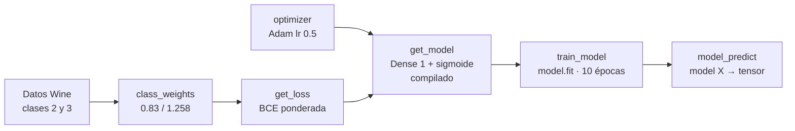

# Tarea 1 — Clasificación lineal

| | |
|---|---|
| **Módulo** | Deep Learning (MLDS 5) · Unidad 1: Introducción al Deep Learning (TensorFlow y Keras) |
| **Archivos** | [v2_M5U1_Tarea_1.ipynb](v2_M5U1_Tarea_1.ipynb) (plantilla sin resolver) · [v2_M5U1_Tarea_1_Resuelto.ipynb](v2_M5U1_Tarea_1_Resuelto.ipynb) (versión entregada) |
| **Calificación** | Automática en **UNCode**: [página de la tarea](https://uncode.unal.edu.co/course/DL-GroupMLDS-5-2026-2/cd16b03a-f1d7-4cc0-9a82-61ed5c8d030d) |
| **Resultado** | ✅ **100 %**: las 12 pruebas en 100 y *"Your submission grade: 100.0%"* |
| **Entorno de ejecución** | Google Colab · Python 3.13.16 · TensorFlow 2.21.0 · Keras 3.13.2 (la plantilla se hizo con Python 3.11, TensorFlow 2.18 y Keras 3.8) |
| **Estructura** | 71 celdas · 6 funciones · 12 pruebas + envío final. Solo se modificaron las 6 celdas de funciones |

## 1. ¿De qué trata la tarea?

Se entrena una **regresión logística**, es decir, una red de **una sola neurona con activación sigmoide**, para distinguir entre dos tipos de vino. El conjunto de datos está **desbalanceado**, así que la pérdida se modifica para que los errores en la clase minoritaria pesen más.

| | |
|---|---|
| **Problema** | Clasificación **binaria**: vino tipo 2 frente a tipo 3 |
| **Dataset** | *Wine* (UCI): 13 características químicas del vino |
| **Modelo** | `Sequential` con una capa `Dense(1)` sigmoide: 13 pesos + 1 sesgo = **14 parámetros** |
| **Pérdida** | **Entropía cruzada binaria ponderada** por clase, escrita a mano |
| **Resultado** | **98,8 %** de accuracy en entrenamiento (82 de 83) tras 10 épocas |

Es el paso previo a la Tarea 2: aquí se entrena un modelo de una neurona; en la Tarea 2 se agregan capas ocultas.

## 2. Flujo de la solución



## 3. Preparación de los datos

1. **Conexión a UNCode:** se crea el objeto `grader` de esta tarea. La autenticación se hizo con el usuario `nremolina`; la contraseña no queda guardada en el notebook.
2. **Carga del dataset:** `wine.data` se descarga del repositorio del curso (`mindlab-unal/mlds5-datasets`).
   - 178 vinos en total: 59 de la etiqueta 1, 71 de la 2 y 48 de la 3.
   - **Solo se usan las etiquetas 2 y 3**, que pasan a ser **0 y 1** (`y − 2`).
   - Las 13 variables se reescalan a [0, 1] con `MinMaxScaler`.
   - `train_test_split(test_size=0.3, stratify=y, random_state=42)` las divide así:

| Partición | Total | Clase 0 (vino 2) | Clase 1 (vino 3) |
|---|---:|---:|---:|
| Entrenamiento | 83 | 50 | 33 |
| Prueba | 36 | 21 | 15 |
| **Total** | **119** | 71 | 48 |

Las salidas del notebook coinciden con las esperadas.

## 4. Concepto clave: pesos por clase

Si una clase tiene menos muestras, el modelo puede ignorarla y aun así obtener un buen resultado global. La solución es **darle más peso a la clase minoritaria dentro de la pérdida**:

$$w_0=\frac{n_0+n_1}{2n_0}, \qquad w_1=\frac{n_0+n_1}{2n_1}$$

$$\mathcal{L}=-\frac{1}{N}\sum_{i=1}^{N}\Big[w_1\,y_i\log(\tilde{y}_i)+w_0\,(1-y_i)\log(1-\tilde{y}_i)\Big]$$

- Ejemplo del enunciado: $n_0=100,\ n_1=50 \Rightarrow w_0=0{,}75,\ w_1=1{,}5$. **Equivocarse con la clase 1 cuesta el doble.**
- Con estos pesos, **el peso promedio por muestra es exactamente 1**: $n_0 w_0 + n_1 w_1 = N$. Por eso la pérdida ponderada queda en la misma escala que la normal.

---

## 5. Lo que se hizo en cada función

### 5.1 Pesos de cada clase · `class_weights(y)`
**Qué pide:** una lista `[w_0, w_1]` calculada a partir de las etiquetas de entrenamiento.

**Qué se hizo:**
```python
def class_weights(y):
    n_0 = np.sum(y == 0)          # muestras de la clase 0
    n_1 = np.sum(y == 1)          # muestras de la clase 1
    w_0 = float((n_0 + n_1) / (2 * n_0))
    w_1 = float((n_0 + n_1) / (2 * n_1))
    weights_list = [w_0, w_1]
    return weights_list
```
- `np.sum(y == k)` cuenta cuántas etiquetas son iguales a `k`, porque cada `True` vale 1.
- `float(...)` convierte el resultado de NumPy a un número de Python, que es el tipo que pide el enunciado.

**Resultado:** `[0.83 1.25758]`, igual al esperado. Con $n_0 = 50$ y $n_1 = 33$: $w_0 = 83/100$ y $w_1 = 83/66$. Pruebas 1_1 y 1_2: **100**.

### 5.2 Entropía cruzada ponderada · `get_loss(class_weights)`
**Qué pide:** una función que **devuelve otra función**, `loss(y_true, y_pred)`, que calcula la pérdida ponderada.

**Qué se hizo:**
```python
def get_loss(class_weights):
    w_0, w_1 = class_weights
    def loss(y_true, y_pred):
        y_true = keras.ops.cast(y_true, y_pred.dtype)       # mismo tipo de dato
        eps = keras.backend.epsilon()
        y_pred = keras.ops.clip(y_pred, eps, 1 - eps)       # evita log(0)
        w_bce = -keras.ops.mean(w_1 * y_true * keras.ops.log(y_pred)
                                + w_0 * (1 - y_true) * keras.ops.log(1 - y_pred))
        return w_bce
    return loss
```
- **Se corrigió la firma de la plantilla**, que traía `get_loss(y_true, y_pred, class_weights)`. Quedó `get_loss(class_weights)`, como la usan las pruebas.
- **Patrón *closure*:** la función interna `loss` "recuerda" `w_0` y `w_1` de la externa. Así Keras recibe una pérdida con solo los dos argumentos que espera, `(y_true, y_pred)`.
- **Dos protecciones que el enunciado no pedía pero hacen la función más robusta:**
  - `cast` iguala el tipo de dato de las etiquetas (enteros) con el de las predicciones (decimales). Sin eso, la multiplicación puede fallar.
  - `clip(y_pred, ε, 1−ε)` evita calcular `log(0)`, que da infinito, cuando el modelo predice exactamente 0 o 1.
- `keras.ops.mean` promedia sobre todas las muestras, como sugiere la Pista 1.

**Resultado:** `weighted_bce = 0.6931471805599454` $= \log 2$, igual al esperado. Pruebas 2_1 y 2_2: **100**.

### 5.3 Optimizador · `optimizer(type_opt, learning_rate)`
**Qué se hizo:**
```python
def optimizer(type_opt, learning_rate):
    if type_opt == 'SGD':
        opt = keras.optimizers.SGD(learning_rate=learning_rate)
    elif type_opt == 'Adam':
        opt = keras.optimizers.Adam(learning_rate=learning_rate)
    elif type_opt == 'RMSprop':
        opt = keras.optimizers.RMSprop(learning_rate=learning_rate)
    else:
        raise ValueError("type_opt debe ser 'SGD', 'Adam' o 'RMSprop'")
    return opt
```
- Elige el optimizador según el texto recibido. Si llega un nombre no válido, falla con un mensaje claro en vez de devolver algo incorrecto.

**Resultado:** `<keras.src.optimizers.adam.Adam at 0x...>`. La ruta `keras.src` y la dirección de memoria difieren de la salida esperada solo por la versión de Keras y por la ejecución. Pruebas 3_1 y 3_2: **100**.

### 5.4 Modelo · `get_model(n_inputs, n_neurons, optimizer, loss)`
**Qué se hizo:**
```python
def get_model(n_inputs, n_neurons, optimizer, loss):
    model = keras.models.Sequential([
        keras.layers.Input(shape=(n_inputs,)),
        keras.layers.Dense(n_neurons, activation='sigmoid')
    ])
    model.compile(optimizer=optimizer, loss=loss)
    return model
```
- **Regresión logística = una capa densa con sigmoide.** La sigmoide convierte la combinación lineal $w \cdot x + b$ en una probabilidad entre 0 y 1.
- El modelo sale **ya compilado** con la pérdida ponderada y el optimizador. Por eso `train_model` puede entrenarlo directamente.

**Resultado:** una capa `Dense` con **14 parámetros** (13 + 1). El nombre `sequential_28` en vez de `sequential` solo indica que la celda se ejecutó varias veces. Pruebas 4_1 y 4_2: **100**.

### 5.5 Entrenamiento · `train_model(model, epochs, optimizer, X_t, Y_t, loss)`
**Qué se hizo:**
```python
def train_model(model, epochs, optimizer, X_t, Y_t, loss):
    history = model.fit(X_t, Y_t, epochs=epochs, verbose=0)   # ya está compilado
    losses = history.history['loss']
    return losses, model.get_weights()
```
- Se entrena con `fit`, siguiendo el ejemplo de regresión logística en Keras del taller guiado de la U1.
- `history.history['loss']` es la lista con la pérdida de cada época.
- Los argumentos `optimizer` y `loss` **no se usan dentro de la función**, porque el modelo ya se compiló con ellos en `get_model`. La firma se mantiene porque el autograder la llama así.

**Resultado:**

| | Esperado | Obtenido |
|---|---|---|
| Pérdida en la época 0 | 0.9399663209915161 | 0.9399663209915161 |
| Pérdida en la época 1 | 0.3858067989349365 | 0.3858067989349365 |
| `w[0]` | 2.2023726 | 2.2023726 |
| `b` | −0.09913202 | −0.09913211 |

La diferencia en el sesgo aparece en la octava cifra decimal y se debe a la versión de TensorFlow. Pruebas 5_1 y 5_2: **100**.

> **¿Por qué la pérdida de la época 0 es 0,94 y no 0,69, si todos los pesos empiezan en cero?** Con pesos en cero el modelo predice 0,5 para todo, y la pérdida inicial es $\log 2 \approx 0{,}69$. Pero `fit` usa lotes de 32 muestras por defecto: con 83 muestras hay **3 actualizaciones por época** (32 + 32 + 19). La pérdida que reporta es el **promedio de los lotes**, y entre un lote y otro los pesos ya cambiaron. Con una tasa de aprendizaje alta (Adam, 0,5), el primer paso se pasa de largo y la pérdida sube en los lotes siguientes. Desde la época 1 baja con rapidez (0,39). Esta explicación es coherente con los valores, pero no se reprodujo lote por lote.

### 5.6 Predicciones · `model_predict(model, X_test)`
**Qué se hizo:**
```python
def model_predict(model, X_test):
    y_pred = model(tf.convert_to_tensor(X_test, dtype=tf.float32))
    return y_pred
```
- **Se corrigió la firma de la plantilla**, que traía `model_predict(log_reg, b, w, X_test)`. Quedó `model_predict(model, X_test)`, como la usan las pruebas.
- **Se llama al modelo directamente**, `model(X)`, en vez de usar `model.predict(X)`. La diferencia es clave:
  - `model(X)` devuelve un **tensor** de TensorFlow, que tiene el método `.numpy()` que usa la prueba;
  - `model.predict(X)` devuelve un arreglo de NumPy, que no lo tiene, y la prueba fallaría.
- `convert_to_tensor(..., float32)` asegura el tipo de dato que espera la capa.

**Resultado:**
- Primeras dos predicciones: `[[0.9925333] [0.0018804]]`. El primer vino es casi con seguridad de clase 1 y el segundo de clase 0.
- **Accuracy de 0,9879518**, igual al esperado.

Pruebas 6_1 y 6_2: **100**.

---

## 6. Resultado del envío

| Punto | Función | Pruebas | Nota |
|---|---|---|---|
| 1 | `class_weights` | 1_1, 1_2 | 100 · 100 |
| 2 | `get_loss` | 2_1, 2_2 | 100 · 100 |
| 3 | `optimizer` | 3_1, 3_2 | 100 · 100 |
| 4 | `get_model` | 4_1, 4_2 | 100 · 100 |
| 5 | `train_model` | 5_1, 5_2 | 100 · 100 |
| 6 | `model_predict` | 6_1, 6_2 | 100 · 100 |
| | **`grader.submit_task`** | | **100.0 %** |

## 7. Lo que se aprende en esta tarea
1. **Una regresión logística es una red neuronal de una neurona:** una capa `Dense(1)` con sigmoide. Todo lo que viene después en el curso se construye sobre esta base.
2. **El desbalance se puede corregir desde la pérdida:** los pesos por clase hacen que equivocarse con la clase minoritaria cueste más, sin quitar ni duplicar datos.
3. **Se pueden escribir pérdidas propias en Keras** con `keras.ops`, siempre que la función reciba `(y_true, y_pred)`. Para pasarle parámetros extra se usa el patrón *closure*.
4. **La estabilidad numérica importa:** recortar las predicciones con ε evita `log(0)`.
5. **`fit` reporta la pérdida promedio de los lotes de cada época**, no la de un único paso. Por eso la primera época puede mostrar una pérdida mayor que la inicial.
6. **`model(X)` y `model.predict(X)` no son lo mismo:** el primero devuelve un tensor y el segundo un arreglo de NumPy.
7. **Hay que leer las celdas de prueba:** dos firmas de la plantilla estaban mal, y la solución correcta fue seguir la forma en que las pruebas llaman a las funciones.

## 8. Observaciones sobre la solución
- **Nunca se evalúa el conjunto de prueba.** El 98,8 % es accuracy de **entrenamiento** (82 de 83), aunque el notebook diga "sobre X_test". Las 36 muestras de prueba no se usan en ningún momento. Para saber cómo generaliza el modelo habría que calcular la misma métrica con `X_test` y `y_test`.
- `class_weights` asume etiquetas 0 y 1. Para más clases habría que generalizar el cálculo, por ejemplo con `np.bincount`.
- Las funciones vuelven a importar `numpy`, `tensorflow` y `keras` adentro. No hace daño y probablemente sirve para que el autograder las ejecute de forma aislada.
- Los números de ejecución no son consecutivos (1, 2, 16…90) porque algunas celdas se ejecutaron más de una vez. No afecta los resultados: las celdas de prueba fijan la semilla y ponen los pesos en cero antes de entrenar.

## 9. Erratas del enunciado
- **Firmas de la plantilla distintas a las pruebas:**
  - `get_loss(y_true, y_pred, class_weights)` frente a `get_loss(class_weights)`;
  - `model_predict(log_reg, b, w, X_test)` frente a `model_predict(model, X_t)`.

  La solución siguió las pruebas.
- **"Tenemos entonces 122 muestras"** es un error: son **119** (83 + 36, o 71 + 48).
- **El accuracy dice "sobre X_test", pero se calcula sobre el conjunto de entrenamiento.** El valor 0,9879518 es exactamente **82/83**.
- **El comentario de la celda 27** dice "FUNCIÓN CALIFICADA weighted_bce", pero la función se llama `get_loss`.
- **El escalado usa todos los datos:** `MinMaxScaler` se ajusta antes de dividir en entrenamiento y prueba, lo que es una pequeña *fuga de información*. Lo correcto sería ajustarlo solo con el entrenamiento.
- **Typos sin efecto:** `weigths`, "vairables", "utilizrá" y "mdoelo".

## 10. Relación con los apuntes del curso
- [U1 · notas.md](../../notas.md): optimizadores (SGD, Adam, RMSprop), regresión logística en TensorFlow y en Keras, y sigmoide con entropía cruzada binaria (diapositivas 57–66).
- La [Tarea 2](../../../02%20-%20Redes%20Neuronales%20Keras/entregables/Tarea%202/documentacion.md) generaliza este modelo: pasa de una neurona sigmoide a redes con capas ocultas, de binario a multiclase (softmax) y luego a regresión. Allí se usa `model.fit` con validación y callbacks.
