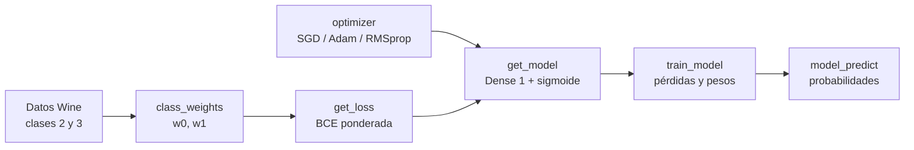

# Tarea 1 — Clasificación lineal

| | |
|---|---|
| **Módulo** | Deep Learning (MLDS 5) · Unidad 1: Introducción al Deep Learning (TensorFlow y Keras) |
| **Archivo** | [v2_M5U1_Tarea_1.ipynb](v2_M5U1_Tarea_1.ipynb), plantilla oficial **sin resolver** |
| **Calificación** | Automática en **UNCode**: [página de la tarea](https://uncode.unal.edu.co/course/DL-GroupMLDS-5-2026-2/cd16b03a-f1d7-4cc0-9a82-61ed5c8d030d) |
| **Entorno de referencia** | Python 3.11.12 · TensorFlow 2.18.0 · Keras 3.8.0 (Google Colab) |
| **Estructura** | 71 celdas · 6 funciones · 12 pruebas + envío final |

## 1. ¿De qué trata la tarea?

Se entrena una **regresión logística**, es decir, una red de **una sola neurona con activación sigmoide**, para distinguir entre dos tipos de vino. El conjunto de datos está **desbalanceado**, así que la pérdida se modifica para que los errores en la clase minoritaria pesen más.

| | |
|---|---|
| **Problema** | Clasificación **binaria**: vino tipo 2 frente a tipo 3 |
| **Dataset** | *Wine* (UCI): 13 características químicas del vino |
| **Modelo** | `Sequential` con una capa `Dense(1)` sigmoide: 13 pesos + 1 sesgo = **14 parámetros** |
| **Pérdida** | **Entropía cruzada binaria ponderada** por clase, escrita a mano |
| **Idea central** | Compensar el desbalance de clases **desde la función de pérdida** |

Es el paso previo a la Tarea 2: aquí se entrena un modelo de una neurona; en la Tarea 2 se agregan capas ocultas.

> La tarea es **incremental**: cada función se usa en los puntos siguientes, así que se resuelve en orden.

## 2. Flujo general



## 3. Preparación de los datos (celdas 0–16)

1. **Conexión a UNCode** (celdas 2–3): igual que en las demás tareas, con el objeto `grader` de esta tarea.
2. **Librerías** (celda 6): NumPy, TensorFlow, Keras y matplotlib. La semilla de NumPy se fija con `seed(1)`.
3. **Carga del dataset** (celdas 10–11): `wine.data` se descarga del repositorio del curso (`mindlab-unal/mlds5-datasets`).
   - 178 vinos en total: 59 de la etiqueta 1, 71 de la 2 y 48 de la 3. La primera columna es la etiqueta.
   - **Solo se usan las etiquetas 2 y 3**, que pasan a ser **0 y 1** (`y − 2`). El texto las llama `class_1` y `class_2` porque cuenta desde cero.
   - Las 13 variables se reescalan a [0, 1] con `MinMaxScaler`.
   - `train_test_split(test_size=0.3, stratify=y, random_state=42)` las divide así:

| Partición | Total | Clase 0 (vino 2) | Clase 1 (vino 3) |
|---|---:|---:|---:|
| Entrenamiento | 83 | 50 | 33 |
| Prueba | 36 | 21 | 15 |
| **Total** | **119** | 71 | 48 |

El desbalance es de unos **60 % / 40 %**, y lo que sigue busca compensarlo.

## 4. Concepto clave: pesos por clase

Si una clase tiene menos muestras, el modelo puede ignorarla y aun así obtener un buen resultado global. La solución es **darle más peso a la clase minoritaria dentro de la pérdida**:

$$w_0=\frac{n_0+n_1}{2n_0}, \qquad w_1=\frac{n_0+n_1}{2n_1}$$

$$\mathcal{L}=-\frac{1}{N}\sum_{i=1}^{N}\Big[w_1\,y_i\log(\tilde{y}_i)+w_0\,(1-y_i)\log(1-\tilde{y}_i)\Big]$$

- Ejemplo del enunciado: $n_0=100,\ n_1=50 \Rightarrow w_0=0{,}75,\ w_1=1{,}5$. **Equivocarse con la clase 1 cuesta el doble.**
- Con estos pesos, **el peso promedio por muestra es exactamente 1**: $n_0 w_0 + n_1 w_1 = N$. Por eso la pérdida ponderada queda en la misma escala que la normal. Esto explica la salida esperada del punto 2.

## 5. Funciones de la tarea

### 5.1 Pesos de cada clase · `class_weights(y)` (calificada)
- **Qué pide:** devolver una **lista** `[w_0, w_1]` con los pesos calculados según las fórmulas anteriores, a partir de las etiquetas de entrenamiento.
- **Cómo se verifica:** con $n_0 = 50$ y $n_1 = 33$: $w_0 = 83/100 = 0{,}83$ y $w_1 = 83/66 = 1{,}25758$. Salida esperada `[0.83 1.25758]`.
- **Pruebas:** `Test 1_1`, `Test 1_2`.

### 5.2 Entropía cruzada ponderada · `get_loss(class_weights)` (calificada)
- **Qué pide:** una función que **devuelve otra función**. `get_loss` recibe los pesos y retorna `loss(y_true, y_pred)`, que calcula la pérdida $\mathcal{L}$ de la sección 4. A este patrón se le llama *closure* o *fábrica de funciones*.
- **Por qué así:** Keras espera una pérdida con solo dos argumentos, `(y_true, y_pred)`. La función interna "recuerda" los pesos de la externa.
- **Pistas del enunciado:** usar `keras.ops.mean` para el promedio y tener en cuenta que la salida debe ser una función.
- **Cómo se verifica:** si todas las predicciones son 0,5, la pérdida es $\log 2 =$ **0,6931471**, porque el peso promedio es 1.
- ⚠️ **Firma inconsistente:** la plantilla define `get_loss(y_true, y_pred, class_weights)`, pero el enunciado y la celda de prueba la usan como `get_loss(class_weights)`. Hay que seguir la forma de la prueba: un solo argumento, y que la función interna reciba `y_true` y `y_pred`.
- **Pruebas:** `Test 2_1`, `Test 2_2`.

### 5.3 Optimizador · `optimizer(type_opt, learning_rate)` (calificada)
- **Qué pide:** devolver un optimizador de `keras.optimizers` según el texto recibido (`'SGD'`, `'Adam'` o `'RMSprop'`), con la tasa de aprendizaje indicada.
- **Cómo se verifica:** `optimizer('Adam', 0.5)` debe devolver un objeto Adam. La dirección de memoria (`0x7f...`) cambia en cada ejecución; no hace falta que coincida.
- **Pruebas:** `Test 3_1`, `Test 3_2`.

### 5.4 Modelo · `get_model(n_inputs, n_neurons, optimizer, loss)`
- **Qué pide:** un modelo **`Sequential`** de regresión logística, ya **compilado** con el optimizador y la pérdida recibidos:
  - entrada de `n_inputs` variables;
  - una capa densa de `n_neurons` salidas con activación **sigmoide**, que convierte la salida en una probabilidad entre 0 y 1.
- **Cómo se verifica:** `get_model(13, 1, opt, loss).summary()` debe mostrar una sola capa `dense` con **14 parámetros**: 13 pesos y 1 sesgo.
- **Pruebas:** `Test 4_1`, `Test 4_2`.

### 5.5 Entrenamiento · `train_model(model, epochs, optimizer, X_t, Y_t, loss)`
- **Qué pide:** entrenar el modelo durante `epochs` épocas y devolver:
  - `losses`: la lista con la pérdida de cada época;
  - los pesos entrenados (`model.get_weights()`, que la plantilla ya retorna).
- **Referencia:** "la construcción del modelo basado en Keras del taller guiado", es decir, la regresión logística en Keras de la U1 (ver [notas.md](../../notas.md), "Modelamiento en Keras").
- **Cómo se verifica:** la celda de prueba fija la semilla, crea el modelo con Adam (`learning_rate = 0.5`), **pone todos los pesos en cero** y entrena 10 épocas:

  ```
  Epoch 0 loss = 0.9399663209915161
  Epoch 1 loss = 0.3858067989349365
  w[0] = [2.2023726]
  b = [-0.09913202]
  ```
- **Pruebas:** `Test 5_1`, `Test 5_2`.

### 5.6 Predicciones · `model_predict(model, X_test)` (calificada)
- **Qué pide:** devolver las predicciones del modelo, es decir, la probabilidad de la clase 1 para cada muestra, con forma `(l, 1)`.
- ⚠️ **Firma inconsistente:** la plantilla define `model_predict(log_reg, b, w, X_test)`, pero el enunciado y la celda de prueba la llaman `model_predict(model, X_t)`, con **dos** argumentos. Hay que seguir la forma de la prueba.
- ⚠️ **Tipo de salida:** la prueba ejecuta `y_pred[:2].numpy()`, así que la función debe devolver un **tensor**, no un arreglo de NumPy. Un arreglo de NumPy no tiene el método `.numpy()`.
- **Cómo se verifica:** las dos primeras predicciones deben ser ≈ `0.9925` y `0.0019`, con accuracy de **0,9879518**.
- **Pruebas:** `Test 6_1`, `Test 6_2`.

## 6. Envío (celda 68)
`grader.submit_task(globals())` envía todas las funciones a UNCode. El resultado se revisa en la página de la tarea.

## 7. Resumen

| Punto | Función | Lo que hace | Pruebas |
|---|---|---|---|
| 1 | `class_weights` | Pesos $w_0$, $w_1$ según el desbalance | 1_1, 1_2 |
| 2 | `get_loss` | Fábrica de la pérdida BCE ponderada | 2_1, 2_2 |
| 3 | `optimizer` | SGD / Adam / RMSprop con la tasa indicada | 3_1, 3_2 |
| 4 | `get_model` | `Sequential` con `Dense(1)` sigmoide, compilado | 4_1, 4_2 |
| 5 | `train_model` | Entrenar y devolver pérdidas y pesos | 5_1, 5_2 |
| 6 | `model_predict` | Probabilidades como tensor `(l, 1)` | 6_1, 6_2 |

## 8. Relación con los apuntes del curso
- [U1 · notas.md](../../notas.md): tensores, variables, `GradientTape`, optimizadores (SGD, Adam, RMSprop), **regresión logística en TensorFlow y en Keras** y la sigmoide con entropía cruzada binaria. Esta tarea lleva a la práctica las diapositivas 57–66 de la U1.
- La [Tarea 2](../../../02%20-%20Redes%20Neuronales%20Keras/entregables/Tarea%202/documentacion.md) generaliza este modelo: pasa de una neurona sigmoide a redes con capas ocultas, de binario a multiclase (softmax) y luego a regresión.

## 9. Detalles y erratas del enunciado
- **Firmas de la plantilla distintas a las pruebas:**
  - `get_loss(y_true, y_pred, class_weights)` frente a `get_loss(class_weights)`;
  - `model_predict(log_reg, b, w, X_test)` frente a `model_predict(model, X_t)`.

  Mandan las celdas de prueba.
- **"Tenemos entonces 122 muestras"** es un error: son **119** (83 + 36, o 71 + 48).
- **El accuracy dice "sobre X_test", pero se calcula sobre el conjunto de entrenamiento** (`X_t = X_train`). El valor esperado 0,9879518 es exactamente **82/83**, o sea, 82 aciertos de las 83 muestras de entrenamiento. El conjunto de prueba (36 muestras) no se evalúa en ningún momento.
- **Comentario de la celda 27:** dice "FUNCIÓN CALIFICADA weighted_bce", pero la función se llama `get_loss`.
- **Nombres de clases:** el texto habla de `class_1` y `class_2` (contando desde cero), el código de "clase 2 y 3" (etiquetas del archivo) y el modelo de 0 y 1. Son las mismas dos clases.
- **El escalado usa todos los datos:** `MinMaxScaler` se ajusta con las 119 muestras **antes** de dividir en entrenamiento y prueba. Es una pequeña *fuga de información*: lo correcto sería ajustarlo solo con el entrenamiento. No afecta la calificación, pero conviene saberlo para el proyecto.
- **Typos sin efecto:** `weigths` (por *weights*), "vairables", "utilizrá" y "mdoelo".
- **`get_model` y `train_model`** no llevan el comentario "FUNCIÓN CALIFICADA", pero sí tienen pruebas (4_x y 5_x).

## 10. Estado

| | |
|---|---|
| Notebook | Plantilla sin resolver |
| Fecha de entrega | _Por registrar_ |
| Resultado en UNCode | _Por registrar_ |
