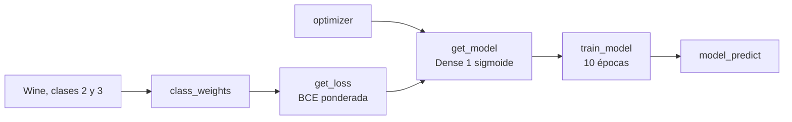

# Tarea 1 — Clasificación lineal · Enunciado

| | |
|---|---|
| **Módulo** | Deep Learning, MLDS 5 · Unidad 1: Introducción al Deep Learning |
| **Notebook** | [v2_M5U1_Tarea_1.ipynb](v2_M5U1_Tarea_1.ipynb), plantilla original sin resolver |
| **Calificación** | Automática en **UNCode** · [página de la tarea](https://uncode.unal.edu.co/course/DL-GroupMLDS-5-2026-2/cd16b03a-f1d7-4cc0-9a82-61ed5c8d030d) |
| **Fecha límite** | 8 de octubre de 2026, 23:59, hora de Colombia |
| **Entorno de referencia** | Python 3.11.12 · TensorFlow 2.18.0 · Keras 3.8.0 |
| **Estructura** | 71 celdas, 33 de código y 38 de texto · 6 funciones calificadas · 12 pruebas y envío final |

## 1. De qué trata la tarea

Se entrena una **regresión logística**, es decir, una red de una sola neurona con activación sigmoide, para distinguir dos tipos de vino del dataset *Wine* de la UCI. Como las clases están **desbalanceadas**, la pérdida se pondera para que los errores en la clase minoritaria cuesten más.

| | |
|---|---|
| **Datos** | 178 vinos con 13 variables químicas. Solo se usan las clases 2 y 3, recodificadas como 0 y 1: 119 muestras |
| **Preparación** | Escalado a [0, 1] con `MinMaxScaler` y división estratificada 70 / 30: 83 de entrenamiento y 36 de prueba |
| **Desbalance** | En entrenamiento hay 50 muestras de la clase 0 y 33 de la clase 1 |
| **Modelo** | `Dense(1)` con sigmoide: 13 pesos y 1 sesgo |

## 2. Flujo

## 3. Funciones

| Punto | Función | Qué pide | Qué trae la plantilla | Cómo se verifica |
|---|---|---|---|---|
| 1 | `class_weights(y)` | Peso de cada clase según el desbalance: `w_k = (n_0 + n_1) / (2 n_k)` | Tres variables en `-1` | `[0.83, 1.25758]` |
| 2 | `get_loss(class_weights)` | Una función que devuelva la entropía cruzada binaria **ponderada** y reciba solo `y_true` y `y_pred` | Una firma equivocada, `get_loss(y_true, y_pred, class_weights)`, y una función interna vacía | `weighted_bce = 0.6931471` con predicciones de 0,5 |
| 3 | `optimizer(type_opt, learning_rate)` | Devolver un optimizador `SGD`, `Adam` o `RMSprop` con la tasa indicada | `opt = -1` | Un objeto `Adam` |
| 4 | `get_model(n_inputs, n_neurons, optimizer, loss)` | Definir y compilar la regresión logística en Keras | `model = None` | Resumen con 14 parámetros |
| 5 | `train_model(model, epochs, optimizer, X_t, Y_t, loss)` | Entrenar y devolver las pérdidas por época y los pesos | `losses = None` | Pérdidas de las épocas 0 y 1, peso `w[0]` y sesgo `b` |
| 6 | `model_predict(model, X_test)` | Devolver las probabilidades del modelo sobre un conjunto | Una firma equivocada, `model_predict(log_reg, b, w, X_test)`, y `y_pred = -1` | Primeras dos predicciones y accuracy de 0,9879518 |

**Celdas que ya vienen completas:** instalación del calificador, librerías, carga y preparación de los datos, conteos por clase, todas las celdas de prueba y las celdas `grader.run_test` y `grader.submit_task`.

## 4. Conceptos clave
- **Regresión logística como red neuronal:** una capa densa de una neurona con activación sigmoide devuelve la probabilidad de la clase 1.
- **Pesos por clase:** con `w_k = N / (2 n_k)`, la clase con menos muestras recibe más peso y el peso promedio por muestra es exactamente 1.
- **Entropía cruzada ponderada:** `−mean(w_1 · y · log ŷ + w_0 · (1 − y) · log(1 − ŷ))`.
- **Closure:** `get_loss` recibe los pesos y devuelve otra función que Keras pueda llamar con `(y_true, y_pred)`.
- **Estabilidad numérica:** recortar las predicciones a `[ε, 1 − ε]` evita `log(0)`.

## 5. Detalles y erratas del enunciado
- **Firmas de la plantilla que no coinciden con las pruebas:**
  - `get_loss(y_true, y_pred, class_weights)` se llama en las pruebas como `get_loss(class_weights)`;
  - `model_predict(log_reg, b, w, X_test)` se llama como `model_predict(model, X_t)`.

  Hay que seguir la forma en que las llaman las celdas de prueba.
- **Requisito que no aparece en el enunciado:** el calificador ejecuta cada función aislada, así que cada una debe importar dentro `numpy`, `tensorflow` y `keras`. Sin eso la prueba falla con `name 'tf' is not defined`.
- **«Tenemos entonces 122 muestras»** es un error: son 119.
- **«Accuracy sobre X_test»:** la celda de prueba lo calcula sobre el entrenamiento. El valor 0,9879518 es exactamente 82/83.
- **El comentario de la celda de la pérdida** dice `weighted_bce`, pero la función se llama `get_loss`.
- **Fuga de información menor:** `MinMaxScaler` se ajusta con todos los datos antes de dividir.
- **Errores de escritura:** «vairables», «utilizrá», «debera», «paramteros», «mdoelo» y `weigths`.
