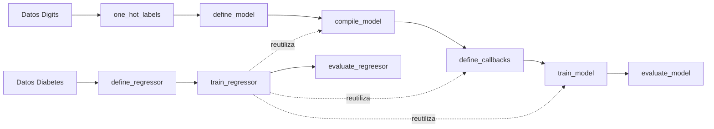

# Tarea 2 — Redes neuronales con Keras

| | |
|---|---|
| **Módulo** | Deep Learning (MLDS 5) · Unidad 2: Redes neuronales en Keras |
| **Archivos** | [v2_M5U2_Tarea_2.ipynb](v2_M5U2_Tarea_2.ipynb) (plantilla vacía) · [v2_M5U2_Tarea_2_Resuelto.ipynb](v2_M5U2_Tarea_2_Resuelto.ipynb) (versión entregada) · [Tarea2_Analisis_de_fondo.pdf](Tarea2_Analisis_de_fondo.pdf) (guía con gráficas) |
| **Calificación** | Automática en **UNCode**: [página de la tarea](https://uncode.unal.edu.co/course/DL-GroupMLDS-5-2026-2/53b13ba1-cfc1-46fe-b4ad-2393da25a238) |
| **Resultado** | ✅ **100 %**: las 18 pruebas en 100 y envío *"Grading succeeded"* |
| **Entorno de ejecución** | Google Colab · Python 3.13.16 · NumPy 2.1.3 · Keras 3.13.2 · scikit-learn 1.9.1 (la plantilla se hizo con Python 3.11, NumPy 2.0 y Keras 3.8) |
| **Estructura** | 101 celdas · 9 funciones calificadas · 18 pruebas + envío final |

## 1. ¿De qué trata la tarea?

La tarea construye **paso a paso el flujo completo de una red neuronal en Keras**: preparar las etiquetas, definir la arquitectura, compilar, configurar callbacks, entrenar y evaluar. Ese flujo se aplica a dos problemas:

| Parte | Problema | Dataset | Salida de la red | Pérdida | Métrica | Resultado obtenido |
|---|---|---|---|---|---|---|
| **1. Clasificación multiclase** | Reconocer dígitos escritos a mano (0–9) | *Digits* (UCI), imágenes de 8×8 = 64 píxeles | 10 neuronas, **softmax** | Entropía cruzada categórica | Accuracy | **92,63 %** en prueba |
| **2. Regresión** | Predecir el avance de la diabetes a un año | *Diabetes* (scikit-learn), 10 variables clínicas | 1 neurona, **lineal** | **MAE** | MAE | **44,67** en prueba |

La idea central es que **la misma red densa sirve para clasificar o para predecir un valor numérico**. Lo que cambia es la capa de salida y la función de pérdida.

## 2. Flujo de la solución



Las funciones de la parte 1 se construyen para **reutilizarlas**: `train_regressor` no repite código, sino que llama a `compile_model`, `define_callbacks` y `train_model`.

## 3. Preparación (celdas 0–13)

1. **Conexión a UNCode:** se instala `rlxcrypt`, se descarga `session.pye` y se crea el objeto `grader`. La autenticación se hizo con el usuario `nremolina` en el curso *Deep learning · Grupo MLDS-5 · 2026-2*. La contraseña no queda guardada en el notebook.
2. **Librerías y semillas:** se fijan `np.random.seed(0)` y `keras.utils.set_random_seed(0)` para que los resultados sean reproducibles. La celda `pip install -U scikit-learn` actualizó scikit-learn de 1.6.1 a 1.9.1 en Colab.
3. **Datos Digits:** 1.797 imágenes de 64 píxeles en 10 clases. Se dividen con `train_test_split(test_size=0.4, stratify=y, random_state=50)` en **1.078** muestras de entrenamiento y **719** de prueba.

---

## 4. Parte 1 — Clasificación multiclase

### Conceptos
- Con más de dos clases se usa **softmax** en la salida y **entropía cruzada categórica** como pérdida, no `sigmoid` ni `BinaryCrossentropy`.
- **Softmax** convierte las salidas en valores entre 0 y 1 que suman 1:

  $$\sigma(z)_i = \frac{e^{z_i}}{\sum_{j=1}^{n} e^{z_j}}$$

  Ejemplo del enunciado: $z = [5, 3, 4] \rightarrow [0.665, 0.090, 0.245]$. La clase predicha es la **0**.

### 1.1 Representación one-hot · `one_hot_labels`
**Qué pide:** convertir las etiquetas enteras en vectores *one-hot* con `keras.utils.to_categorical`.

**Qué se hizo:**
```python
def one_hot_labels(y_train, y_test):
    num_classes = int(max(np.max(y_train), np.max(y_test))) + 1
    y_train_ohe = keras.utils.to_categorical(y_train, num_classes=num_classes)
    y_test_ohe = keras.utils.to_categorical(y_test, num_classes=num_classes)
    return y_train_ohe, y_test_ohe
```
- El número de clases se calcula a partir de **ambas** particiones (la etiqueta más alta + 1). Así el entrenamiento y la prueba siempre tienen el mismo número de columnas, aunque a una de las dos le falte alguna clase. Sin ese parámetro, `to_categorical` deduciría el tamaño por separado en cada arreglo.
- Con Digits se obtienen matrices `(1078, 10)` y `(719, 10)`.

**Resultado:** la salida coincide exactamente con la esperada. Pruebas 1_1_1 y 1_1_2: **100**.

### 1.2 Definición del modelo · `define_model`
**Qué pide:** una red con el **API funcional**, con capas ocultas ReLU y salida softmax.

**Qué se hizo:**
```python
def define_model(input_shape, hidden_layers, hidden_units, output_units):
    keras.utils.set_random_seed(0)
    inputs = keras.layers.Input(shape=(input_shape,))
    x = inputs
    for _ in range(hidden_layers):
        x = keras.layers.Dense(hidden_units, activation='relu')(x)
    outputs = keras.layers.Dense(output_units, activation='softmax')(x)
    model = keras.Model(inputs=inputs, outputs=outputs)
    return model
```
- **API funcional:** cada capa se "llama" sobre la salida de la anterior (`Dense(...)(x)`). Al final, `keras.Model(inputs, outputs)` une la entrada con la salida.
- El ciclo `for` permite elegir cuántas capas ocultas tiene la red con `hidden_layers`.

**Resultado:** `define_model(64, 2, 16, 10)` tiene **1.482 parámetros**, igual que el esperado:

| Capa | Cálculo (pesos + sesgos) | Parámetros |
|---|---|---:|
| Densa 1 | 64 × 16 + 16 | 1.040 |
| Densa 2 | 16 × 16 + 16 | 272 |
| Salida | 16 × 10 + 10 | 170 |
| **Total** | | **1.482** |

Pruebas 1_2_1 y 1_2_2: **100**.

### 1.3 Compilación · `compile_model`
**Qué se hizo:**
```python
def compile_model(model, loss, optimizer, metrics):
    keras.utils.set_random_seed(0)
    model.compile(loss=loss, optimizer=optimizer, metrics=metrics)
    return model
```
Compilar le indica al modelo **qué minimizar** (la pérdida), **cómo** hacerlo (el optimizador) y **qué reportar** (las métricas).

**Resultado:** `get_compile_config()` muestra Adam con `learning_rate ≈ 0.001`, la pérdida `categorical_crossentropy` y la métrica `['acc']`, igual que el esperado. Pruebas 1_3_1 y 1_3_2: **100**.

### 1.4 Callbacks · `define_callbacks`
**Qué se hizo:**
```python
def define_callbacks(filepath, metric, mode, patience):
    checkpoint = keras.callbacks.ModelCheckpoint(filepath=filepath, monitor=metric, mode=mode,
                                                 save_best_only=True, save_weights_only=True, verbose=1)
    stopping = keras.callbacks.EarlyStopping(monitor=metric, mode=mode, patience=patience,
                                             restore_best_weights=True, verbose=1)
    callbacks = [checkpoint, stopping]
    return callbacks
```

| Callback | Configuración | Para qué sirve |
|---|---|---|
| `ModelCheckpoint` | `save_best_only=True`, `save_weights_only=True` | Guarda en disco solo los **pesos** y solo cuando la métrica mejora |
| `EarlyStopping` | `patience`, `restore_best_weights=True` | Detiene el entrenamiento si no hay mejora en `patience` épocas y **vuelve a cargar los pesos de la mejor época**, como pide la nota del enunciado |

- `mode` (`'min'` o `'max'`) indica si la métrica debe bajar (una pérdida) o subir (el accuracy).
- `verbose=1` hace que el registro muestre mensajes como *"loss improved… saving model"* o *"Restoring model weights…"*.

**Resultado:** la configuración impresa coincide con la esperada. Pruebas 1_4_1 y 1_4_2: **100**.

### 1.5 Entrenamiento · `train_model`
**Qué se hizo:**
```python
def train_model(model, X_train, y_ohe_train, epochs, batch_size, validation_rate, callbacks):
    keras.utils.set_random_seed(0)
    history = model.fit(X_train, y_ohe_train, epochs=epochs, batch_size=batch_size,
                        validation_split=validation_rate, callbacks=callbacks)
    return history, model
```
- `validation_split` aparta el **último** 20 % del conjunto de entrenamiento (216 muestras) para validar. Quedan 862 para entrenar, es decir, 14 lotes de 64.
- `fit` devuelve un objeto `History` con la pérdida y las métricas de cada época, que se usa para graficar las curvas.

**Resultado (5 épocas):** la pérdida baja en cada época: 4,02 → 2,44 → 2,07 → 1,85 → 1,66. Al final se restauran los pesos de la época 5, igual que en la salida esperada. Pruebas 1_5_1 y 1_5_2: **100**.

### 1.6 Evaluación · `evaluate_model`
**Qué se hizo:**
```python
def evaluate_model(model, X_test, y_ohe_test):
    loss, acc = model.evaluate(X_test, y_ohe_test)
    return acc
```
`evaluate` devuelve `[pérdida, métrica]`, así que se separan los dos valores y se retorna el accuracy.

**Resultado:** `Accuracy en test: 0.4186`, igual al esperado. Es bajo porque el modelo solo entrenó 5 épocas. Pruebas 1_6_1 y 1_6_2: **100**.

### Entrenamiento más largo (no calificable)
Se usan las mismas funciones con más capacidad de entrenamiento: Adam con `learning_rate = 1e-2`, `EarlyStopping` sobre `val_loss` con paciencia de 10, máximo 50 épocas, batch de 64 y 20 % de validación.

| | Salida esperada (versión anterior de Keras) | Obtenido (Keras 3.13) |
|---|---|---|
| Época en que se detiene | 21 | 30 |
| Mejor época (pesos restaurados) | 11 | 20 |
| Mejor `val_loss` | 0,2066 | 0,2077 |
| **Accuracy en prueba** | **0,9263** | **0,9263** |

El recorrido del entrenamiento cambia con la versión de Keras, pero el **accuracy final es idéntico: 92,63 %**. Pasar de 5 épocas a un entrenamiento con parada temprana sube el accuracy de 41,9 % a 92,6 %.

---

## 5. Parte 2 — Regresión

### Conceptos
En regresión se predice un **valor continuo**:
- la salida es **lineal** (sin activación que la limite);
- la pérdida mide la distancia entre la predicción y el valor real. Se usa **MAE** (error absoluto medio), que está en las mismas unidades que la variable objetivo. El MSE penaliza más los errores grandes.

### Datos Diabetes
- 442 pacientes con 10 variables (edad, sexo, IMC, presión arterial y 6 mediciones de suero), ya normalizadas.
- La variable objetivo es el avance de la enfermedad a un año, con valores entre 25 y 346.
- `train_test_split(test_size=0.3, random_state=13)` da **309** muestras de entrenamiento y **133** de prueba.
- No se usa one-hot porque el objetivo es un número.

### 2.1 Definición del regresor · `define_regressor`
**Qué se hizo:**
```python
def define_regressor(input_shape, hidden_layers, hidden_units, output_units):
    keras.utils.set_random_seed(0)
    keras.backend.clear_session()
    inputs = keras.layers.Input(shape=(input_shape,))
    x = inputs
    for _ in range(hidden_layers):
        x = keras.layers.Dense(hidden_units, activation='relu')(x)
    outputs = keras.layers.Dense(output_units, activation='linear')(x)
    model = keras.Model(inputs=inputs, outputs=outputs)
    return model
```
- Es la misma estructura que `define_model`. La **única diferencia es `activation='linear'`** en la salida.
- `clear_session()` reinicia el estado de Keras para que los nombres de las capas (`dense`, `dense_1`…) coincidan con los esperados.

**Resultado:** `define_regressor(10, 2, 8, 1)` tiene **169 parámetros** (88 + 72 + 9), igual que el esperado. Pruebas 2_1_1 y 2_1_2: **100**.

### 2.2 Compilación y entrenamiento · `train_regressor`
**Qué se hizo:**
```python
def train_regressor(model, filepath, X_train, y_train, epochs, batch_size,
                    learning_rate, validation_rate):
    model = compile_model(model, keras.losses.MeanAbsoluteError(),
                          keras.optimizers.Adam(learning_rate=learning_rate), metrics=['mae'])
    callbacks = define_callbacks(filepath, 'val_loss', 'min', 10)
    history, model = train_model(model, X_train, y_train, epochs, batch_size,
                                 validation_rate, callbacks)
    return history, model
```
Cumple cada requisito del enunciado **reutilizando** las funciones de la parte 1:

| Requisito | Cómo se cumple |
|---|---|
| Pérdida MAE | `keras.losses.MeanAbsoluteError()` |
| Optimizador Adam | `keras.optimizers.Adam(learning_rate=learning_rate)` |
| Monitorear la pérdida en validación con paciencia 10 | `define_callbacks(filepath, 'val_loss', 'min', 10)` |
| Reportar la métrica MAE | `metrics=['mae']` |

**Resultado (50 épocas, `learning_rate = 0.05`):** el MAE de validación baja de 162,7 a **46,28**. Se restauran los pesos de la época 48, igual que en la salida esperada. Pruebas 2_2_1 y 2_2_2: **100**.

### 2.3 Evaluación · `evaluate_regreesor`
**Qué se hizo:**
```python
def evaluate_regreesor(model, X_test, y_test):
    loss, mae = model.evaluate(X_test, y_test)
    return mae
```
Se mantuvo el nombre del enunciado, con doble "e", porque UNCode lo busca así.

**Resultado:** `MEA en test: 44.6665`, idéntico al esperado. En promedio el modelo se equivoca en **unos 45 puntos** sobre una escala de 25 a 346. Pruebas 2_3_1 y 2_3_2: **100**.

---

## 6. Análisis de fondo de los resultados

Esta sección resume el PDF [Tarea2_Analisis_de_fondo.pdf](Tarea2_Analisis_de_fondo.pdf) (12 páginas) y lo contrasta con el notebook entregado. La sección 6.6 dice qué cifras se comprobaron y cómo.

### 6.1 Qué pasó en el entrenamiento largo de clasificación

| Época | Pérdida de entrenamiento | Pérdida de validación | Accuracy de validación |
|---:|---:|---:|---:|
| 1 | 2,600 | 1,938 | 0,296 |
| 10 | 0,144 | 0,326 | 0,903 |
| 15 | 0,096 | 0,223 | 0,931 |
| **20 (mejor)** | 0,043 | **0,208** | **0,958** |
| 30 (se detiene) | 0,010 | 0,242 | 0,954 |

- **Hay sobreajuste desde la época 15:** la pérdida de entrenamiento sigue bajando hasta 0,01, pero la de validación oscila entre 0,21 y 0,30 sin mejorar de forma sostenida. El modelo empieza a memorizar los datos de entrenamiento.
- **El early stopping hizo su trabajo:**
  - la mejor `val_loss` (0,2077) fue en la época 20;
  - en las 10 épocas siguientes no mejoró;
  - en la época 30 el entrenamiento se cortó y se restauraron los pesos de la época 20.

  Por eso nunca llega a la época 50.
- **Por qué sube tanto frente a las 5 épocas (41,86 % → 92,63 %):** más épocas, una tasa de aprendizaje 10 veces mayor (`1e-2`) y el corte guiado por la validación.

### 6.2 Qué dígitos falla el modelo

El modelo final acierta **666 de 719** imágenes de prueba (92,63 %).

| Dígito | Aciertos | % | | Dígito | Aciertos | % |
|---|---|---:|---|---|---|---:|
| **3** | 59 / 73 | **80,8** | | 5 | 68 / 73 | 93,2 |
| 7 | 63 / 72 | 87,5 | | 4 | 70 / 72 | 97,2 |
| 1 | 64 / 73 | 87,7 | | 6 | 71 / 72 | 98,6 |
| 8 | 63 / 70 | 90,0 | | 0 | 71 / 71 | 100 |
| 9 | 66 / 72 | 91,7 | | 2 | 71 / 71 | 100 |

- **El 3 es el dígito más difícil**: falla 14 de 73. Los 0 y los 2 se aciertan todos.
- **Las confusiones más frecuentes**, de mayor a menor:

  | Confusión | Casos |
  |---|---:|
  | 1 → 8 | 7 |
  | 3 → 9 | 6 |
  | 7 → 4 | 5 |

  Son dígitos con trazos parecidos en una imagen de solo 8×8 píxeles.

### 6.3 Qué pasó en el entrenamiento del regresor

- **El early stopping nunca se activó.** La validación siguió mejorando de a poco (mejoras en las épocas 30, 31, 34, 40, 45 y **48**), así que la paciencia de 10 nunca se agotó y corrió las 50 épocas.
- El MAE de validación bajó de 162,7 a **46,28**, en la época 48, y se restauraron esos pesos.
- La brecha entre entrenamiento (41,8 en la época 48) y validación (46,3) es pequeña: **no hay sobreajuste marcado**.

### 6.4 ¿Es bueno un MAE de 44,67?

| Modelo | MAE en prueba |
|---|---:|
| Predecir siempre el promedio de `y_train_2` (línea base) | 62,98 |
| **Red neuronal 10 → 8 → 8 → 1 (la de la tarea)** | **44,67** |
| Regresión lineal de scikit-learn, misma partición | 43,46 |

- **La red reduce el error en un 29 %** frente a predecir siempre el promedio.
- **Una regresión lineal simple da prácticamente lo mismo**, incluso un poco mejor. Con 309 muestras y 10 variables, una red pequeña no tiene mucho más que aprender. Es una lección importante: **una red neuronal no siempre le gana a un modelo clásico**, sobre todo con datos tabulares pequeños.
- En la prueba el objetivo va de 40 a 306, así que equivocarse en promedio en unas 45 unidades es un error moderado.

### 6.5 Cómo elegir la salida y la pérdida según el problema

| Problema | Activación de salida | Pérdida | Formato de etiquetas | Métrica |
|---|---|---|---|---|
| Binario | `sigmoid` (1 neurona) | `BinaryCrossentropy` | 0 / 1 | accuracy |
| Multiclase | `softmax` (c neuronas) | `CategoricalCrossentropy` | one-hot | accuracy |
| Multiclase con etiquetas enteras | `softmax` | `SparseCategoricalCrossentropy` | 0 … c−1 | accuracy |
| Regresión | `linear` | MSE o MAE | número real | MAE |

- **La entropía cruzada castiga con −log(p)** la probabilidad que se le asigna a la clase correcta. Si la red le da 0,665 a la clase verdadera, la pérdida es **0,41**; si le da 0,09, sube a **2,41**.
- **Errores comunes** según la guía:
  - usar `Sequential` cuando piden el API funcional;
  - olvidar `save_weights_only=True` con una ruta `.weights.h5`, lo que en Keras 3 da error;
  - no poner `restore_best_weights=True`, con lo que el modelo queda con los pesos de la última época y no los de la mejor.

### 6.6 Verificación del PDF

| Afirmación del PDF | Estado | Cómo se comprobó |
|---|---|---|
| 18 pruebas en 100 y envío al 100 % | ✅ Correcta | Salidas HTML del notebook resuelto |
| Pérdidas por época del entrenamiento corto, 0,4186, 1.482 y 169 parámetros, MAE 44,6665 | ✅ Correctas | Registros del notebook |
| Entrenamiento largo: corte en la época 30, mejor época 20, `val_loss` 0,20765, `val_acc` 0,958 y pérdida final 0,01 | ✅ Correctas | Registros del notebook, época por época |
| Regresor: mejoras en las épocas 40, 45 y 48, entrenamiento 41,7 y validación 46,3 | ✅ Correctas | Registros del notebook |
| Línea base 62,98, regresión lineal 43,46, reducción del 29 % y rango de prueba 40–306 | ✅ Correctas | Recalculadas con scikit-learn y la misma partición |
| Entropía cruzada 0,41 y 2,41 | ✅ Correcta | −ln(0,665) y −ln(0,09) |
| 666 / 719 aciertos y totales por dígito | ✅ Coherente | Los aciertos suman 666 y los totales por clase coinciden con la partición estratificada |
| Aciertos por dígito y confusiones (1→8, 3→9, 7→4) | ⚠️ Coherente, sin reproducir | Salen de una reproducción aparte del modelo; el notebook entregado no tiene la matriz de confusión. Cuadran con los errores por dígito |
| "La validación se estanca entre 0,21 y 0,25 desde la época 15" | ⚠️ Impreciso | Oscila entre 0,21 y **0,30** (época 16: 0,302) |
| El texto lista las confusiones "3→9 (6), 1→8 (7), 7→4 (5)" como las más frecuentes | ⚠️ Orden incorrecto | La más frecuente es 1→8 (7). Arriba quedaron ordenadas |
| "Ejecutar las celdas en desorden mueve los decimales" | ⚠️ Exagerado | Cada función vuelve a fijar la semilla (`set_random_seed(0)`), así que el orden pesa poco. Lo que sí cambia son los nombres de las capas en el `summary()`. De todos modos, ejecutar en orden es buena práctica |
| Usar `metrics=['accuracy']` en vez de `['acc']` "puede hacer fallar los tests" | ⚠️ No verificado | Es plausible, porque cambia la clave en `history`, pero no se probó |
| Duración del envío (≈ 1 minuto) y aviso de "modo solo lectura" en Colab | ⚪ No verificable | No queda registro en el notebook |

## 7. Resultado del envío

| Punto | Función | Pruebas | Nota |
|---|---|---|---|
| 1.1 | `one_hot_labels` | 1_1_1, 1_1_2 | 100 · 100 |
| 1.2 | `define_model` | 1_2_1, 1_2_2 | 100 · 100 |
| 1.3 | `compile_model` | 1_3_1, 1_3_2 | 100 · 100 |
| 1.4 | `define_callbacks` | 1_4_1, 1_4_2 | 100 · 100 |
| 1.5 | `train_model` | 1_5_1, 1_5_2 | 100 · 100 |
| 1.6 | `evaluate_model` | 1_6_1, 1_6_2 | 100 · 100 |
| 2.1 | `define_regressor` | 2_1_1, 2_1_2 | 100 · 100 |
| 2.2 | `train_regressor` | 2_2_1, 2_2_2 | 100 · 100 |
| 2.3 | `evaluate_regreesor` | 2_3_1, 2_3_2 | 100 · 100 |
| | **`grader.submit_task`** | | **Grading succeeded · 100 %** |

## 8. Lo que se aprende en esta tarea
1. **El flujo de Keras** es siempre el mismo: definir → compilar → entrenar → evaluar.
2. **El API funcional** (`Input` → capas → `Model`) permite construir redes de profundidad variable con un ciclo.
3. **El tipo de problema decide la salida y la pérdida:**
   - clasificación multiclase: softmax + entropía cruzada + one-hot;
   - regresión: salida lineal + MAE o MSE.
4. **Los callbacks automatizan buenas prácticas:**
   - guardar el mejor modelo (`ModelCheckpoint`);
   - detener a tiempo para evitar el sobreajuste y restaurar los mejores pesos (`EarlyStopping`).
5. **Monitorear la validación, no el entrenamiento**, es lo que permite detener en el momento correcto. Por eso el entrenamiento largo llega a 92,6 % y no se queda con los pesos sobreajustados de la época 30 (ver la sección 6.1).
6. **Escribir funciones reutilizables** ahorra código: la parte 2 se resolvió casi entera con las funciones de la parte 1.
7. **Hay que comparar con una línea base.** La red de regresión mejora un 29 % frente a predecir el promedio, pero una regresión lineal simple da casi el mismo resultado (ver la sección 6.4).

## 9. Observaciones sobre la solución
- **`evaluate` con desempaquetado:** `loss, acc = model.evaluate(...)` funciona porque el modelo se compiló con **una sola** métrica. Con más métricas habría que usar `model.evaluate(..., return_dict=True)` y leer la clave correspondiente.
- **`validation_split` toma el final de los datos sin mezclar.** Aquí no afecta, porque `train_test_split` ya mezcló los datos. Con datos ordenados por clase, la validación quedaría sesgada.
- La regresión trabaja con las variables ya normalizadas que trae el dataset. Con datos propios habría que estandarizarlos antes de entrenar.

## 10. Erratas del enunciado
- **Nombres que no se deben corregir:** `evaluate_regreesor` (con doble "e") y la etiqueta `MEA` en el `print`, que debería ser MAE. UNCode busca la función con ese nombre exacto.
- **Mínimo de prueba de Diabetes:** la salida esperada dice `((309, 10), (133, 10), 346.0, 25.0)`, pero el código imprime `y_test_2.min()`, que vale **40.0**. 25 es el mínimo de *entrenamiento*. Se comprobó con el mismo `random_state=13`. La salida del notebook resuelto (40.0) es la correcta.
- En la fórmula de softmax el enunciado escribe $x_i$ aunque el vector se llama $z$.
- En el punto 1.1, la descripción de `y_test` dice "conjunto de entrenamiento"; debería decir prueba.
- En el punto 2.3 el texto habla de "exactitud o *accuracy*", pero en regresión se calcula el **MAE**.
- La salida esperada del entrenamiento largo viene de una versión anterior de Keras (`Epoch 1/100`, `test_checkpoint.h5`).
- *Diabetes* no viene de la UCI: es el dataset de Efron et al. (2004) que trae scikit-learn.

## 11. Relación con los apuntes del curso
- [U1 · notas.md](../../../01%20-%20Intro%20TensorFlow%20PyTorch%20Keras/notas.md): tensores, `GradientTape`, optimizadores y regresión logística en TensorFlow y en Keras. Esta tarea pasa de esa regresión logística (una sola neurona) a redes con capas ocultas.
- U2, redes neuronales en Keras: el PDF de la clase 2 aún no está en el repositorio.
