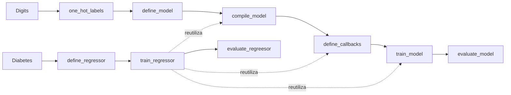

# Tarea 2 — Redes neuronales con Keras · Enunciado

| | |
|---|---|
| **Módulo** | Deep Learning, MLDS 5 · Unidad 2: Redes neuronales en Keras |
| **Notebook** | [v2_M5U2_Tarea_2.ipynb](v2_M5U2_Tarea_2.ipynb), plantilla original sin resolver |
| **Calificación** | Automática en **UNCode** · [página de la tarea](https://uncode.unal.edu.co/course/DL-GroupMLDS-5-2026-2/53b13ba1-cfc1-46fe-b4ad-2393da25a238) |
| **Fecha límite** | 15 de octubre de 2026, 23:59, hora de Colombia |
| **Entorno de referencia** | Python 3.11.12 · NumPy 2.0.2 · Keras 3.8.0 |
| **Estructura** | 101 celdas, 49 de código y 52 de texto · 9 funciones calificadas · 18 pruebas y envío final |

## 1. De qué trata la tarea

Se construye, función por función, **el flujo completo de una red neuronal en Keras**: preparar las etiquetas, definir la arquitectura, compilar, configurar *callbacks*, entrenar y evaluar. El mismo flujo se aplica a dos problemas:

| Parte | Problema | Datos | Salida de la red | Pérdida |
|---|---|---|---|---|
| **1 · Clasificación multiclase** | Reconocer dígitos escritos a mano | *Digits*: 1.797 imágenes de 8 × 8 = 64 píxeles, 10 clases. 1.078 de entrenamiento y 719 de prueba | 10 neuronas con *softmax* | Entropía cruzada categórica |
| **2 · Regresión** | Predecir el avance de la diabetes a un año | *Diabetes*: 442 pacientes con 10 variables clínicas. 309 de entrenamiento y 133 de prueba | 1 neurona lineal | MAE |

## 2. Flujo

## 3. Funciones

| Punto | Función | Qué pide | Qué trae la plantilla | Cómo se verifica |
|---|---|---|---|---|
| 1.1 | `one_hot_labels(y_train, y_test)` | Convertir las etiquetas a *one-hot* con `keras.utils.to_categorical` | Dos variables en `None` | Matrices *one-hot* de un ejemplo de 3 clases |
| 1.2 | `define_model(input_shape, hidden_layers, hidden_units, output_units)` | Red con la **API funcional**, `hidden_layers` capas ReLU y salida *softmax* | La semilla y `model = None` | Resumen con 1.482 parámetros |
| 1.3 | `compile_model(model, loss, optimizer, metrics)` | Compilar el modelo con la pérdida, el optimizador y las métricas recibidas | La semilla y `model = None` | `get_compile_config()` |
| 1.4 | `define_callbacks(filepath, metric, mode, patience)` | `ModelCheckpoint` que guarde solo el mejor y `EarlyStopping` que restaure los mejores pesos | Dos variables en `None` y la lista ya armada | Atributos de ambos *callbacks* |
| 1.5 | `train_model(model, X_train, y_ohe_train, epochs, batch_size, validation_rate, callbacks)` | Entrenar con validación y devolver `history` y el modelo | La semilla y `history = None` | Registro de 5 épocas |
| 1.6 | `evaluate_model(model, X_test, y_ohe_test)` | Devolver la accuracy en prueba | `acc = -1` | 0,4186 tras 5 épocas |
| 2.1 | `define_regressor(input_shape, hidden_layers, hidden_units, output_units)` | Igual que 1.2, con salida **lineal** | La semilla, `clear_session()` y `model = None` | Resumen con 169 parámetros |
| 2.2 | `train_regressor(model, filepath, X_train, y_train, epochs, batch_size, learning_rate, validation_rate)` | Compilar con MAE, crear *callbacks* y entrenar, **reutilizando** las funciones de la parte 1 | Dos variables en `None` | Registro de 50 épocas |
| 2.3 | `evaluate_regreesor(model, X_test, y_test)` | Devolver el MAE en prueba | `mae = None` | 44,6665 |

**Celdas que ya vienen completas:** instalación del calificador, librerías y semillas, carga de ambos datasets, las celdas de prueba, el entrenamiento más largo no calificable y las celdas `grader.run_test` y `grader.submit_task`.

## 4. Conceptos clave
- **Softmax:** convierte las salidas en probabilidades que suman 1; con *one-hot* y entropía cruzada categórica forma el estándar de clasificación multiclase.
- **API funcional:** `Input` → capas → `Model`. Permite construir con un ciclo una red de profundidad variable.
- **`ModelCheckpoint` y `EarlyStopping`:** guardan los mejores pesos según una métrica y detienen el entrenamiento cuando deja de mejorar.
- **Validación con `validation_split`:** reserva una fracción del entrenamiento para monitorear sin tocar la prueba.
- **Regresión:** salida lineal y una pérdida de distancia, como MAE o MSE.

## 5. Detalles y erratas del enunciado
- **Nombres que no se deben corregir:** `evaluate_regreesor`, con doble «e», y la etiqueta `MEA` del `print`. El calificador busca la función con ese nombre exacto.
- **Mínimo de prueba de Diabetes:** la salida esperada dice 25.0, pero el código imprime `y_test_2.min()`, que vale **40.0**; 25 es el mínimo de entrenamiento.
- **Fórmula de softmax:** escribe `x_i` aunque el vector se llama `z`.
- **Punto 1.1:** la descripción de `y_test` dice «conjunto de entrenamiento»; debería decir prueba.
- **Punto 2.3:** habla de «exactitud o *accuracy*», pero en regresión se calcula el MAE.
- **Entrenamiento largo:** su salida esperada viene de una versión anterior de Keras, con `Epoch 1/100` y `test_checkpoint.h5`.
- **Procedencia de *Diabetes*:** no viene de la UCI; es el dataset de Efron y colaboradores, 2004, incluido en scikit-learn.
- **Errores de escritura:** «compildo», «optmizer», «tuvieramos», «necesairios», «absolto», «reproducibiidad».
