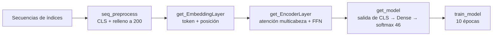

# Tarea 4 — Transformers · Enunciado

| | |
|---|---|
| **Módulo** | Deep Learning (MLDS 5) · Unidad 4: Modelos de lenguaje y Transformers |
| **Calificación** | Automática en **UNCode**: [página de la tarea](https://uncode.unal.edu.co/course/DL-GroupMLDS-5-2026-2/3feead7a-0040-47fc-b701-11492b6ea6c8) |
| **Entorno de referencia** | Python 3.11.12 · NumPy 2.0.2 · Keras 3.8.0 · **se recomienda GPU** |
| **Estructura** | 55 celdas · 5 funciones calificadas · 11 pruebas + envío final |

> No se cargó la plantilla en blanco: el archivo recibido ya trae el código escrito y está en [../resuelto/](../resuelto/README.md). Este documento describe lo que pide el enunciado.

## 1. ¿De qué trata la tarea?

Se construye **desde cero un clasificador basado en Transformer** para asignar cada noticia a uno de **46 temas**.

| | |
|---|---|
| **Dataset** | *Reuters newswire* de Keras: **11.228 noticias**, 8.982 de entrenamiento y 2.246 de validación |
| **Entrada** | Cada noticia llega como una lista de índices de palabras; el vocabulario se limita a 20.000 |
| **Modelo** | Embeddings de token y de posición → **un bloque codificador Transformer** → representación del token **`[CLS]`** → perceptrón → *softmax* de 46 clases |

Es la versión mínima de la arquitectura de BERT, con una sola capa de codificador y entrenada desde cero.

## 2. Flujo

## 3. Funciones

| Punto | Función | Qué pide | Cómo se verifica |
|---|---|---|---|
| 1 | `seq_preprocess(X, cls_id, max_len)` | Igualar la longitud de todas las secuencias a `max_len`. Antepone el token `[CLS]` y **rellena al final**; el `[CLS]` cuenta dentro de `max_len` | Formas `(8982, 200)` y `(2246, 200)` |
| 2 | `get_EmbeddingLayer(max_len, vocab_size, embed_dim)` | Capa personalizada de Keras que **suma el embedding del token y el de su posición**. La atención por sí sola no conoce el orden de las palabras | Salida `(10, 200, 128)` |
| 3 | `get_EncoderLayer(embed_dim, num_heads, ff_dim, rate)` | Bloque codificador: atención multicabeza → *dropout* → suma residual + normalización → red *feed-forward* → *dropout* → suma residual + normalización | La forma se conserva: `(10, 200, 128)` |
| 4 | `get_model(...)` | Une las piezas y toma la salida de la **posición 0** (`[CLS]`) como resumen de la noticia. Encima van una capa densa de `n_neurons` y una *softmax* de 46 clases. Se compila con Adam y una pérdida categórica **dispersa**, porque las etiquetas son enteros | 327.802 parámetros: 323.200 de embeddings, 3.296 del bloque, 340 y 966 de las capas densas |
| 5 | `train_model(...)` | Preprocesar entrenamiento y validación con `seq_preprocess` y entrenar con `fit` | Accuracy de validación ≈ **0,68** tras 10 épocas (0,6808 en la salida esperada) |

## 4. Conceptos clave
- **Token `[CLS]`:** una posición extra al inicio cuya representación final, después de la atención, resume toda la secuencia. Es la que usa el clasificador.
- **Embedding posicional:** la atención es invariante al orden, así que se suma un vector aprendido por cada posición.
- **Atención multicabeza:** cada cabeza aprende relaciones distintas entre palabras de la noticia.
- **Conexiones residuales y normalización de capa:** estabilizan el entrenamiento del bloque.
- **Pérdida dispersa** (`sparse_categorical_crossentropy`): permite usar etiquetas enteras (0–45) sin convertirlas a *one-hot*.

## 5. Detalles y erratas del enunciado
- **Salida esperada de `get_config()`:** muestra `embed_dim: 32`, aunque la celda construye el modelo con `embed_dim = 16`. Ese resultado viene de otra ejecución.
- **Configuración de las capas:** esa misma salida incluye `embed_dim`, `max_len`, `vocab_size`, `num_heads`, `ff_dim` y `rate` dentro de la configuración de las capas personalizadas. Para que aparezcan, las clases deben implementar `get_config()`.
- **Salidas de `train_model`:** el enunciado dice "modelo e `history`", pero la celda de prueba recibe un solo valor (`history = train_model(...)`).
- **Errores de escritura:** "noticas", "ejeución", "ejemeplo", "sequencias", "estrutura", "deperdida".
