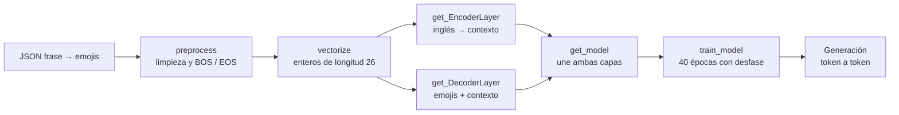

# Tarea 5 — Modelos generativos · Enunciado

| | |
|---|---|
| **Módulo** | Deep Learning, MLDS 5 · Unidad 5: Modelos generativos y multimodalidad |
| **Notebook** | [v2_M5U5_Tarea_5.ipynb](v2_M5U5_Tarea_5.ipynb), plantilla original sin resolver |
| **Calificación** | Automática en **UNCode** · [página de la tarea](https://uncode.unal.edu.co/course/DL-GroupMLDS-5-2026-2/8c487bd7-4c95-4b75-88d5-9e7093aae729) |
| **Entorno de referencia** | Python 3.11.12 · NumPy 2.0.2 · Keras 3.8.0 · **se recomienda GPU**; el notebook viene configurado con una T4 |
| **Estructura** | 60 celdas, 33 de código y 27 de texto · 6 funciones calificadas · 11 pruebas y envío final |

## 1. De qué trata la tarea

Se construye un **Transformer codificador-decodificador** que convierte frases en inglés en secuencias de emojis. El enunciado aclara que no es una traducción de palabra a símbolo: el modelo debe captar el contexto semántico, los conceptos clave y las emociones implícitas, y producir una secuencia coherente.

| | |
|---|---|
| **Datos** | `emoji_translations.json`, unas 10.000 parejas de frase y emojis, descargadas de Google Drive con `gdown` |
| **División** | La plantilla ya la trae hecha: 6.605 frases de entrenamiento y 3.129 de prueba |
| **Modelo** | Inglés → codificador → contexto → decodificador con atención cruzada → *softmax* sobre 5.000 tokens de emojis |

## 2. Flujo

## 3. Funciones

| Punto | Función | Qué pide | Qué trae la plantilla | Cómo se verifica |
|---|---|---|---|---|
| 1 | `preprocess(data)` | **Inglés:** minúsculas, solo letras y espacios, sin espacios repetidos, y `[BOS]` y `[EOS]`. **Emojis:** solo `[BOS]` y `[EOS]` | Las dos funciones internas con `pass`; la aplicación con `.map` ya está escrita | Imprime la fila 0 de ambas columnas |
| 2 | `vectorize(X, seq_len, vocab_size)` | Crear y ajustar un vectorizador para el inglés y otro para los emojis | Dos variables en `None` | Formas `(6605, 26)` en entrada y salida |
| 3 | `get_EncoderLayer(...)` | Capa personalizada de Keras con el codificador de un Transformer | La clase `encoder` con `__init__` y `call` vacíos, y `layer = None` | Salida `(10, 26, 128)` |
| 4 | `get_DecoderLayer(...)` | Capa personalizada con el decodificador. `call` recibe los emojis y la salida del codificador, `context_tokens` | La clase `Decoder` vacía; **la instancia final ya está escrita** | Sin salida esperada; la forma correcta es `(10, 25, 5000)` |
| 5 | `get_model(...)` | Unir codificador y decodificador en un `keras.Model` | Las semillas y `clear_session()`; `model = None` | Resumen con 784.160 + 1.561.256 = **2.345.416 parámetros** |
| 6 | `train_model(...)` | Entrenar el modelo y devolver `history`, **desfasando un token** la salida esperada respecto a la entrada | `history = None` | Salida esperada de las épocas 39 y 40 |

**Celdas que ya vienen completas:** instalación del calificador, librerías y semillas, carga y división de los datos, la función de pérdida `causal_loss`, la llamada `train_model(..., 1e-4, 40, 256)`, el bucle de generación de ejemplo y todas las celdas `grader.run_test` y `grader.submit_task`.

## 4. Conceptos clave
- **Tokens `[BOS]` y `[EOS]`:** marcan el inicio y el fin. El decodificador arranca con `[BOS]` y aprende a terminar con `[EOS]`.
- **Longitudes 26 y 25:** el vectorizador produce 26 posiciones. El codificador las usa todas. El decodificador recibe 25 porque la secuencia de emojis se recorta un token para crear el desfase.
- **Máscara causal:** en el decodificador, cada posición solo puede mirar las anteriores.
- **Atención cruzada:** las consultas salen de los emojis y las claves y valores, del contexto del codificador.
- **`causal_loss`:** entropía cruzada que ignora las posiciones de relleno, es decir, los ceros. Usa `from_logits=False`, así que la salida del decodificador debe ser *softmax*.
- **Generación autorregresiva:** la plantilla parte del token 3, `[BOS]`, y se detiene al producir el token 2, `[EOS]`.

## 5. Detalles y erratas del enunciado
- **Salida esperada de `preprocess` engañosa.** Muestra los emojis separados por espacios, `[BOS] ✅ 🗳 ️ [EOS]`, con un espacio incluso antes del selector de variación invisible de 🗳️. La instrucción escrita dice solo «añadir los tokens», y el calificador da 100 únicamente con los emojis **sin separar**.
- **Nombre de columna:** la entrada de `preprocess` dice que el DataFrame tiene las columnas «texto» y «emojis»; en realidad son `ingles` y `emojis`.
- **Nota fuera de lugar:** la nota del punto 2 sobre añadir tokens a los emojis corresponde al punto 1.
- **«Modelo compilado»:** el punto 6 describe `model` como «modelo de Keras compilado», pero `get_model` lo devuelve sin compilar. `train_model` tiene que llamar a `compile`.
- **Asimetría en la plantilla:** el codificador termina en `layer = None`, mientras que el decodificador ya trae `layer = Decoder(...)`.
- **Requisitos que no aparecen en el enunciado** y que el calificador sí revisa:
  - los nombres exactos de los atributos de las capas, como `self_att`, `cross_att` u `out_layer`;
  - el `dropout=rate` dentro de `MultiHeadAttention`.

  El detalle está en el [balance](../balance.md).
- **Salida esperada del entrenamiento:** en la época 40 muestra pérdida de 0,12, accuracy de 0,0805 y validación de 4,86. La accuracy de 0,0805 es casi 2/25 y la de validación, 0,041, casi 1/25. La referencia memoriza el entrenamiento mucho más que la versión resuelta.
- **Errores de escritura:** «prerpocesamiento», «ejeución», «debera», «incio», «reproducibiidad», «sequencias», «epocas».
