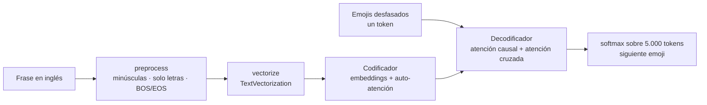

# Tarea 5 — Modelos generativos · Paso a paso

| | |
|---|---|
| **Módulo** | Deep Learning, MLDS 5 · Unidad 5: Modelos generativos y multimodalidad |
| **Archivo** | [v2_M5U5_Tarea_5_Resuelto.ipynb](v2_M5U5_Tarea_5_Resuelto.ipynb) |
| **Calificación** | UNCode · [página de la tarea](https://uncode.unal.edu.co/course/DL-GroupMLDS-5-2026-2/8c487bd7-4c95-4b75-88d5-9e7093aae729) |
| **Resultado** | ✅ **100 %**: las 11 pruebas en 100 y *"Your submission grade: 100.0%"* |
| **Entorno** | Google Colab con Python 3.13.16, NumPy 2.4.6 y Keras 3.13.2; la plantilla se hizo con Python 3.11, NumPy 2.0 y Keras 3.8 |

## 1. De qué trata

Se construye **desde cero un Transformer codificador-decodificador** que traduce frases en inglés a secuencias de emojis. Es un problema **secuencia a secuencia**:
- el codificador lee la frase completa;
- el decodificador genera los emojis uno a uno, mirando lo que ya generó y lo que dice la frase.

| | |
|---|---|
| **Datos** | Pares frase–emojis de un archivo JSON. Las frases vienen de debates parlamentarios, por ejemplo «parliament agreed to accept the oral amendment» → ✅💬 |
| **Partición** | 70 % entrenamiento y 30 % prueba: 6.605 y 3.129 pares |
| **Modelo** | Codificador de 784.160 parámetros y decodificador de 1.561.256, con 2.345.416 en total |

Es la arquitectura original de *Attention Is All You Need* en su versión mínima: una capa de codificador y una de decodificador.

## 2. Flujo



## 3. Lo que se hizo en cada función

### 3.1 Preprocesamiento · `preprocess(data)`
```python
def preprocess_text(text):
    text = text.lower()                        # minúsculas
    text = re.sub(r'[^a-z\s]', '', text)       # solo letras y espacios
    text = re.sub(r'\s+', ' ', text).strip()   # espacios repetidos
    return '[BOS] ' + text + ' [EOS]'
def preprocess_emoji(emoji):
    return '[BOS] ' + emoji + ' [EOS]'
```
- **Al texto** se le aplican, en este orden, las cuatro reglas del enunciado: minúsculas, solo letras y espacios, espacios repetidos fuera y los tokens `[BOS]` y `[EOS]`.
- **A los emojis** solo se les agregan los tokens de inicio y fin.
- `[BOS]` le indica al decodificador dónde empezar y `[EOS]`, dónde detenerse.

**Resultado:** `[BOS] the ratification and implementation of the updated ilo conventions vote [EOS]`. Pruebas 1_1 y 1_2: **100**.

### 3.2 Vectorización · `vectorize(X, seq_len, vocab_size)`
```python
en_vectorizer = keras.layers.TextVectorization(max_tokens=vocab_size, output_mode='int',
                                               output_sequence_length=seq_len + 1, standardize=None)
# el de emojis es igual; cada uno se ajusta con adapt() sobre su columna
```
- Hay **un vocabulario por idioma**: uno para el inglés y otro para los emojis.
- `standardize=None` es clave: si se dejara la estandarización por defecto, Keras borraría la puntuación y los corchetes de `[BOS]` y `[EOS]`.
- `output_sequence_length = seq_len + 1`, es decir 26. Ese token extra permite desfasar la salida del decodificador en el entrenamiento.

**Resultado:** entradas y salidas de forma `(6605, 26)`, iguales a las esperadas. Pruebas 2_1 y 2_2: **100**.

### 3.3 Codificador · `get_EncoderLayer(...)`
- **Embedding de token más embedding de posición:** la atención no conoce el orden de las palabras, así que se le suma la posición.
- **Auto-atención multicabeza:** cada palabra de la frase mira a todas las demás.
- **Dropout, suma residual y normalización de capa.**
- **Red *feed-forward*** de dos capas densas, con el mismo patrón de dropout, suma residual y normalización.

**Resultado:** salida `(10, 26, 128)`, un vector de 128 dimensiones por token. Pruebas 3_1 y 3_2: **100**.

### 3.4 Decodificador · `get_DecoderLayer(...)`
Tiene la misma estructura del codificador, más dos piezas propias de la generación:
1. **Auto-atención causal**, con `use_causal_mask=True`: cada posición solo puede mirar los emojis anteriores. Así el modelo no "ve el futuro" que debe predecir.
2. **Atención cruzada** con la salida del codificador: cada emoji que se genera consulta la frase en inglés.
3. **Capa de salida *softmax*** sobre los 5.000 tokens del vocabulario de emojis, que da la probabilidad del siguiente token.

**Resultado:** salida `(10, 25, 5000)`. Pruebas 4_1 y 4_2: **100**.

### 3.5 Modelo completo · `get_model(...)`
- Tiene dos entradas: la frase con 26 tokens y los emojis desfasados con 25.
- El codificador produce el contexto y el decodificador lo combina con los emojis previos.
- El `summary()` coincide exactamente con el esperado: **784.160 + 1.561.256 = 2.345.416 parámetros**.

**Verificación del codificador:**

| Componente | Parámetros |
|---|---:|
| Embeddings | 640.000 + 3.328 |
| Auto-atención | 131.968 |
| Red *feed-forward* | 8.352 |
| Normalizaciones | 512 |

Pruebas 5_1 y 5_2: **100**.

### 3.6 Entrenamiento · `train_model(...)`
```python
model.compile(optimizer=keras.optimizers.Adam(learning_rate=learning_rate),
              loss=causal_loss, metrics=['accuracy'])
history = model.fit([train_text, train_emoji[:, :-1]], train_emoji[:, 1:],
                    validation_data=([test_text, test_emoji[:, :-1]], test_emoji[:, 1:]),
                    epochs=epochs, batch_size=batch_size)
```
- **Entrenamiento con *teacher forcing*:** el decodificador recibe los emojis reales sin el último, `[:, :-1]`, y debe predecir esos mismos emojis corridos una posición, `[:, 1:]`. Así, en cada paso aprende a predecir el siguiente token.
- **Pérdida `causal_loss`**, dada por la plantilla: entropía cruzada que **ignora el relleno**, porque se multiplica por una máscara de los tokens distintos de 0.

**Resultado tras 40 épocas:** pérdida de entrenamiento 3,48 y de validación 3,85. Prueba 6_1: **100**.

**Ejemplo de generación:**
- **Frase:** *«we also have a common responsibility to ensure that this takes place with legal certainty while [UNK] fundamental rights»*.
- **Proceso:** se parte de `[BOS]` y en cada paso se elige el token más probable, decodificación voraz, hasta llegar a `[EOS]`.
- **Salida generada:** `🇪🇺❌🚫`.

## 4. Resultado del envío

| Punto | Función | Pruebas | Nota |
|---|---|---|---|
| 1 | `preprocess` | 1_1, 1_2 | 100 · 100 |
| 2 | `vectorize` | 2_1, 2_2 | 100 · 100 |
| 3 | `get_EncoderLayer` | 3_1, 3_2 | 100 · 100 |
| 4 | `get_DecoderLayer` | 4_1, 4_2 | 100 · 100 |
| 5 | `get_model` | 5_1, 5_2 | 100 · 100 |
| 6 | `train_model` | 6_1 | 100 |
| | **Envío** | | **100 %** |

## 5. Observaciones

- **Cada combinación de emojis es un único token.** La salida esperada del punto 1 muestra los emojis separados por espacios, `[BOS] ✅ 🗳 ️ [EOS]`, de modo que cada emoji sería un token. La solución los deja juntos, `[BOS] ✅🗳️ [EOS]`. Por eso el vocabulario de salida aprende **combinaciones completas**, y el ejemplo genera `🇪🇺❌🚫` como un solo token. Las pruebas pasaron igual, pero así el modelo no puede recombinar emojis que nunca vio juntos.
- **La curva de entrenamiento difiere de la esperada:**

  | Pérdida tras 40 épocas | Entrenamiento | Validación |
  |---|---:|---:|
  | Salida esperada | 0,12 | 4,86 |
  | Esta ejecución | 3,48 | 3,85 |

  La diferencia es coherente con la tokenización anterior. Con un token por emoji, el modelo de la plantilla memoriza el entrenamiento y sobreajusta, porque su validación empeora. Con un token por combinación, el modelo aprende más despacio y no llega a memorizar.
- **La accuracy reportada no es informativa:** queda entre 0,04 y 0,13 porque se calcula sobre las 25 posiciones, incluido el relleno, mientras que la pérdida lo ignora. La salida esperada también es baja, 0,08. Para medir la calidad de la generación convendría una accuracy con máscara o métricas como BLEU.
- **Partición:** se hace con `.loc`, que incluye el extremo, así que la fila del corte puede quedar tanto en entrenamiento como en prueba. Tampoco se baraja antes de dividir.
- **Errores de escritura del enunciado:** "prerpocesamiento", "incio", "ejeución", "sequencias" y "reproducibiidad". El enlace del asistente en los créditos apunta a `https://http://juselara.com/`.

## 6. Lo que se aprende
1. **Arquitectura codificador-decodificador:** el codificador entiende la entrada y el decodificador genera la salida token a token, consultándola con atención cruzada.
2. **La máscara causal** es lo que convierte un Transformer en un modelo generativo: cada posición solo usa el pasado.
3. ***Teacher forcing*:** en el entrenamiento se alimenta la secuencia real desfasada un token. En la inferencia se generan los tokens uno a uno, desde `[BOS]` hasta `[EOS]`.
4. **La tokenización define lo que el modelo puede generar:** con un token por emoji el modelo combina símbolos; con un token por combinación solo elige entre las que ya vio.
5. **La pérdida con máscara** evita que el relleno domine el aprendizaje, y la métrica debería ignorarlo de la misma forma.

## 7. Relación con los apuntes del curso
- La [Tarea 4](../../../../04%20-%20Modelos%20de%20Lenguaje%20y%20Transformers/entregables/Tarea%204/README.md) usa solo el codificador para clasificar. Esta tarea agrega el decodificador, con atención causal y atención cruzada, para **generar**.
